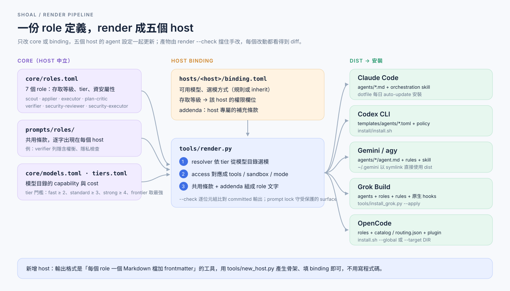
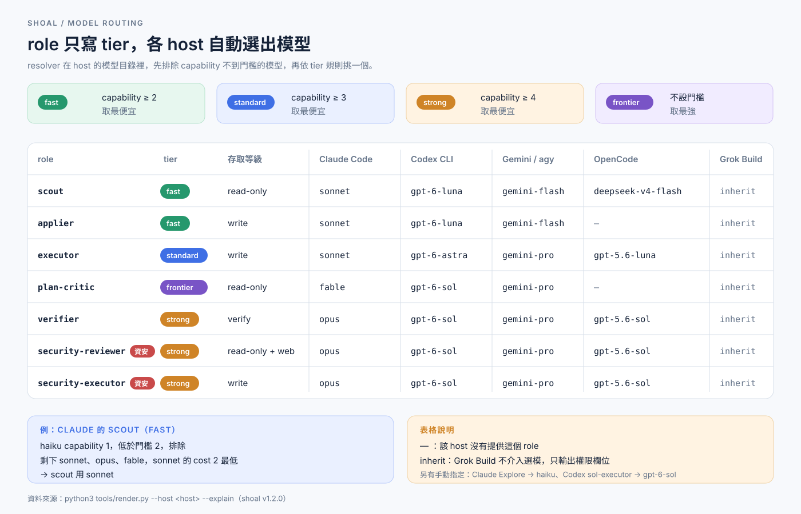
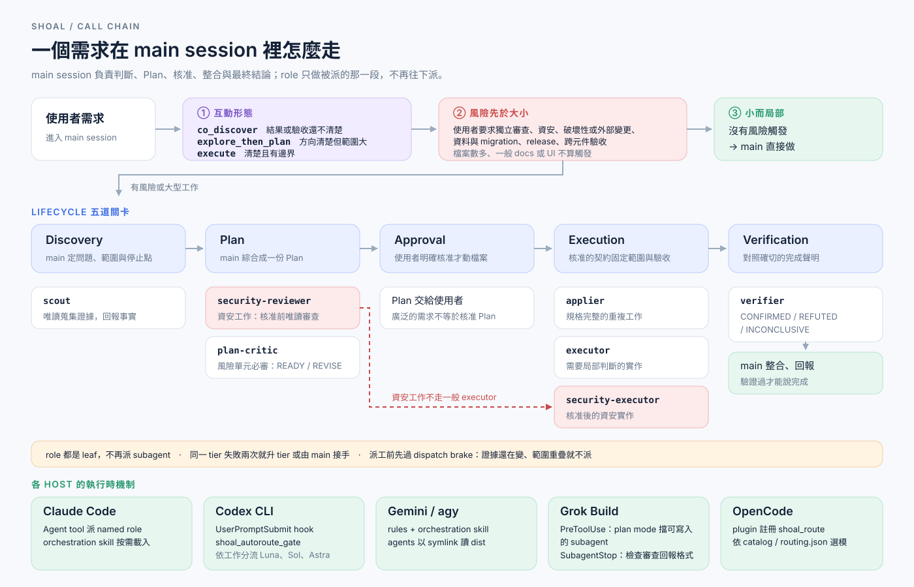

# Shoal-Codex installation playbook（shoal 的 Codex host 安裝說明）

This playbook is for an AI agent installing the native Shoal-Codex target.
Read it completely before running an installation command. The detailed
ownership and migration rules are in
[`install/AGENT-INSTALL.md`](install/AGENT-INSTALL.md); this playbook does not
replace that runbook.

## Scope and prerequisites

The installer changes one Codex home. The default is `~/.codex`; set the
`CODEX_HOME` environment variable or pass `--codex-home` to select another
home. It installs the
native shoal roles, the active bootstrap block in the selected root
`AGENTS.md`, the `shoal-codex` Plugin/Skill through Codex's local
marketplace contract, native config, and the shoal hook registration and
script. It does not install an
adapter, change shell startup files, manage credentials, or use `sudo`.

Before any run, confirm all of the following:

- Codex CLI is `>=0.147.0` (one bare version token; a suffix or an ambiguous
  `--version` result is not accepted; the installer enforces this floor, newer
  releases are expected to work).
- Python is `3.11` or newer.
- A local POSIX checkout has Bash and Python; a native Windows checkout has
  PowerShell and Python. No network tools are needed for the local path.
- A remote POSIX path additionally needs `curl`, `tar`, `mktemp`, and network
  access to `github.com`; a remote PowerShell path uses
  `Invoke-WebRequest` and `tar`. The remote archive is selected by a visible
  ref.
- The POSIX entrypoint is `install/install.sh`; the native Windows entrypoint is
  `install/install.ps1`; the actual installer remains `install/install.py`.
  `--ref` belongs to either wrapper and must not be passed to `install.py`.

Do not print or copy `auth.json`, tokens, API keys, or other credentials while
inspecting the home.

## Optional Astra main-session mode

The installer keeps the default root Luna/Plan and Sol review policy. The
automatic route may use the installed strong `executor`/`verifier` bindings.
To opt into Astra for the root session itself, start Codex with launch-time
overrides instead of editing `config.toml`. `<strong-model>` is the model your
Codex binding resolves for the strong tier; see
`python3 tools/render.py --host codex --explain`.

```bash
codex --model <strong-model> \
  -c model_reasoning_effort="high" \
  -c plan_mode_reasoning_effort="high" \
  -c agents.max_concurrent_threads_per_session=1
```

This activation is zero-write and session-only. The prompt keeps Astra on
synthesis, planning, and difficult judgment; delegates mechanical work to
Luna; and preserves `plan-critic` on Sol/high plus all approval and security
gates. `max_tool_calls=12` and `max_wall_seconds=300` are advisory limits, not
a provider-enforced quota. An invalid override or unavailable Astra model must
fail closed before task work; start a new session without the flags to return
to the normal policy. No installer option enables this mode by default.

## Confirmation boundary

The agent may fetch this playbook, inspect source, check versions, read the
documented configuration files, and run `--help` or `--dry-run` without
approval. A remote dry-run downloads a pinned archive into the installer's
private temporary directory; it does not write the Codex home.

Stop immediately after the dry-run and before any real install command that
targets the selected home. Show the user:

- the absolute Codex home path;
- the selected source and ref;
- every `would change primary:` path;
- the policy and hook changes;
- existing files that will receive a timestamped
  `*.shoal-codex-<timestamp>` backup; and
- any role drift, extra role, pending transaction, or unresolved hook
  registration ownership that caused an abort.

Ask for explicit approval to back up and write that home. Approval must name
the path and does not authorize replacing customized same-name roles,
deleting residual roles, changing credentials, or using elevated privileges.
If the user does not approve, stop with no install command.

## Inspect before execution

From a checkout, inspect both the thin shell wrapper and the detailed runbook
before invoking the wrapper:

```bash
sed -n '1,220p' install/install.sh
sed -n '1,260p' install/AGENT-INSTALL.md
bash install/install.sh --help
```

For a remote-only run, fetch `INSTALL.md` and the shell entrypoint from the
same pinned ref, then inspect the unpacked `install/AGENT-INSTALL.md` and
`install/install.sh` before proceeding. Do not silently substitute `main` for a
requested pinned ref.

Check the prerequisites and select the target home without changing it:

```bash
python3 --version
codex --version
SHOAL_TARGET_HOME="${CODEX_HOME:-$HOME/.codex}"
printf 'target home=%s\n' "$SHOAL_TARGET_HOME"
```

Inspect only the managed inputs. Preserve unrelated config and custom role
files; do not read credentials:

```bash
if [ -f "$SHOAL_TARGET_HOME/config.toml" ]; then
  sed -n '1,240p' "$SHOAL_TARGET_HOME/config.toml"
fi
for policy in "$SHOAL_TARGET_HOME/AGENTS.md" "$SHOAL_TARGET_HOME/AGENTS.override.md"; do
  if [ -s "$policy" ]; then
    printf '\n--- %s ---\n' "$policy"
    sed -n '1,260p' "$policy"
  fi
done
if [ -d "$SHOAL_TARGET_HOME/agents" ]; then
  find "$SHOAL_TARGET_HOME/agents" -maxdepth 1 -type f -name '*.toml' -print
fi
```

If both policy files are non-empty, or if a pending state sidecar exists, stop
for operator resolution before a dry-run. The detailed runbook defines the
legacy migration and ownership evidence that must remain intact.

## Dry-run

Use one of these entrypoints. Local checkout is always the first source choice
when the shell script is executed from a valid checkout.

Local checkout:

```bash
SHOAL_TARGET_HOME="${CODEX_HOME:-$HOME/.codex}"
bash install/install.sh --dry-run --codex-home "$SHOAL_TARGET_HOME"
```

Native Windows PowerShell:

```powershell
$shoalHome = if ($env:CODEX_HOME) { $env:CODEX_HOME } else { Join-Path $HOME ".codex" }
.\install\install.ps1 --dry-run --codex-home $shoalHome
```

Pinned remote source (replace the placeholder with an exact published tag or
full commit SHA; do not run the placeholder itself):

```bash
SHOAL_TARGET_HOME="${CODEX_HOME:-$HOME/.codex}"
SHOAL_REF='<release-tag-or-commit-sha>'
curl -fsSL \
  "https://raw.githubusercontent.com/miyago9267/shoal/${SHOAL_REF}/install/install.sh" \
  | bash -s -- --ref "$SHOAL_REF" --dry-run \
    --codex-home "$SHOAL_TARGET_HOME"
```

Note: pinned refs before v1.0.0 (v1.8.1 and earlier) exist only in
`miyago9267/pilotfish-codex`; use that repository name in the URL for them.

If the active home has a dotfiles-managed `AGENTS.md` or `hooks` symlink that
points outside the home, use the isolated role path instead of integrating the
full target:

```bash
bash install/install.sh --dry-run --roles-only \
  --codex-home "$SHOAL_TARGET_HOME"
bash install/install.sh --roles-only \
  --codex-home "$SHOAL_TARGET_HOME"
```

`--roles-only` writes only the `agents/*.toml` role files. It leaves policy,
config, hooks, Plugin, and installer state untouched; existing same-name role
customizations still require an explicit replacement option.

`--ref=<release-tag-or-commit-sha>` is equivalent to the two-argument form.
Keep the raw script URL ref and the archive ref identical. `SHOAL_REF` is
only the wrapper fallback when `--ref` is omitted. The wrapper prints
`selected source:` and `selected ref:` before a remote fetch.

A successful dry-run prints `would change primary:` lines and allowed state,
backup, and pending-artifact names, or says that the target is already up to
date. It must not create those artifacts. A failed dry-run is a stop signal;
resolve its ownership or state error rather than weakening the installer.
When the host Plugin registry is unavailable, the native runtime still installs
but the committed state records Plugin status as `unavailable`; this is a
fallback, not proof that the Skill is active.

## Install after approval

After the user approves the exact home and planned writes, rerun the same
source and ref without `--dry-run`.

Local checkout:

```bash
SHOAL_TARGET_HOME="${CODEX_HOME:-$HOME/.codex}"
bash install/install.sh --codex-home "$SHOAL_TARGET_HOME"
```

Native Windows PowerShell:

```powershell
$shoalHome = if ($env:CODEX_HOME) { $env:CODEX_HOME } else { Join-Path $HOME ".codex" }
.\install\install.ps1 --codex-home $shoalHome
```

Pinned remote source:

```bash
SHOAL_TARGET_HOME="${CODEX_HOME:-$HOME/.codex}"
SHOAL_REF='<release-tag-or-commit-sha>'
curl -fsSL \
  "https://raw.githubusercontent.com/miyago9267/shoal/${SHOAL_REF}/install/install.sh" \
  | bash -s -- --ref "$SHOAL_REF" \
    --codex-home "$SHOAL_TARGET_HOME"
```

The wrapper forwards only installer arguments such as `--dry-run`,
`--roles-only`, and `--codex-home`; it consumes `--help` and `--ref`. It
validates a remote ref before constructing the codeload URL, uses no `eval` or
`sudo`, and removes only its own temporary directory.

If the active policy path is a symlink managed by the user's dotfiles, the
installer stops by default. After verifying the target, explicitly authorize
integration with `--follow-policy-symlink --policy-root <contained-root>`; this
preserves the symlink and writes only its regular-file target. A stale committed
policy fingerprint likewise stops by default. Use
`--reconcile-current` only after the dry-run confirms the current policy/config
are the intended source of truth; the resulting state version 4 records the
accepted preimages, target identity, previous sidecar digest, post-merge
fingerprints, and rollback paths. Plugin installation may update only its own
`plugins`/`marketplaces` entries; a foreign config mutation aborts.

## Validate and trust the hook

When a checkout is available, validate the installed config and role manifest:

```bash
python3 install/validate_agents.py \
  --config "$SHOAL_TARGET_HOME/config.toml" "$SHOAL_TARGET_HOME/agents"
```

The expected result is:
`all native shoal config and agent TOMLs valid`.
Also confirm that these managed hook files exist, without printing secrets:

```bash
test -f "$SHOAL_TARGET_HOME/hooks.json"
test -f "$SHOAL_TARGET_HOME/hooks/shoal_autoroute_gate.py"
test -f "$SHOAL_TARGET_HOME/hooks/shoal_guard.py"
grep -F 'Shoal automatic typed Plan-review gate.' \
  "$SHOAL_TARGET_HOME/hooks.json"
```

### Dispatch guard

Since host 1.8.3 the installer also registers the dispatch guard
(`hooks/shoal_guard.py --host codex`,
[`docs/specs/dispatch-enforcement`](./docs/specs/dispatch-enforcement/SPEC.md))
next to the autoroute gate. It is a separate script with its own projection ID
(`shoal-dispatch-guard-v1`, called `shoal-guard-v5` before 3.8.0) and its own
state entry (`guard_registration`), so the gate
is unchanged. It adds a `UserPromptSubmit` group that records the turn and
reads `#direct`, a `PreToolUse` group with matcher
`^(apply_patch|spawn_agent|collaborationspawn_agent|Bash)$`, and, since 3.4.0,
a `Stop` group for the completion check (below), since the legacy
`shoal-guard-v4` a
`SubagentStart` group without a matcher that tells the guard a dispatched role
has really started (below), and since the legacy `shoal-guard-v5` a
`PostToolUse` group
with matcher `^Bash$` that lets the completion check count a shell call that
really ran (below). The guard is in
enforce mode by default (`SHOAL_GUARD=shadow` logs `would_deny` and `advise`
records under `${XDG_STATE_HOME:-~/.local/state}/shoal/guard/`;
`SHOAL_GUARD=off` disables it). The subagent rules (LEAF, VERIFY_EDIT) deny.
Since 3.3.0 the main-session edit rule is the same `strict` rule as on Claude
(`SHOAL_GUARD_R1=strict`, the default; 3.2.1 and 3.2.x defaulted to
`declare`): `apply_patch` and a `Bash` call that literally writes a file are
denied unless the turn has a dispatched write role or a standalone `#direct`
in the prompt (or `SHOAL_GUARD_DIRECT=1`). A declaration is no exit in
`strict`. The earlier `declare` rule (exit: a `Bash` call that is exactly `:
shoal-direct "<reason>"`; see the Claude guard section below), the
reminder-only `SHOAL_GUARD_R1=classified` and `SHOAL_GUARD_R1=off` stay
selectable. R2 still only reminds. Shell-write detection is a literal
reading of the command text (redirects, `tee`, `sed -i`, `perl -i`): writes
through an interpreter such as `python -c` or `node -e`, or through `cp`, `mv`,
`patch` and `dd`, are not caught. The background-shell rule G4 does not exist
on Codex (its shell calls carry no `run_in_background`). The rule is built on
a recorded payload of Codex CLI 0.160.1: the shell tool is `Bash` with
`tool_input.command`, the same `turn_id` is on the prompt and tool events, and
main-session calls have no `agent_id` (keys and types:
`tests/fixtures/codex_payload_shapes.json`;
[`docs/specs/guard-declared-direct/PROGRESS.md`](./docs/specs/guard-declared-direct/PROGRESS.md)).
A foreground `Bash` call that neither declares nor writes a file gets no
opinion and writes no log line (after a change in the turn it records that a
check ran, see the completion check below). An existing home that predates the
guard gains the script and all three groups on the next install; a home
registered by an earlier release is upgraded in place: `shoal-guard-v1` (3.2.0 or
earlier, matcher without `Bash`) has its `PreToolUse` group replaced at the same
position, `v1` and `v2` (3.2.1 to 3.3.1) gain the guard's own `Stop`
group, appended after the existing `Stop` entries, and `v1` to `v3` gain the
`SubagentStart` group (`v3` changes nothing else), and `v1` to `v4` gain the
`PostToolUse` group (an earlier, unreleased `v4` install is upgraded in
place). Every other entry (your own
`Bash` matcher, your own `Stop` hook, the autoroute gate's own `Stop` group) is
left untouched. Re-runs change nothing. The installer does not write hook
trust: after installing **or upgrading to 3.4.0**, approve the new `Stop` hook
once in an interactive Codex session with `/hooks`, as for the autoroute gate.
Without that approval Codex does not run it and the completion check never
fires (nothing else changes). A `PreToolUse` group that is not re-approved
after an upgrade from `v1` leaves the guard blind to `Bash` (declarations then
have no way in, so keep `#direct` and dispatch in mind until you approve).
**Approve the new `SubagentStart` hook once with `/hooks` after upgrading to
`shoal-guard-v4`, and the new `PostToolUse` hook after upgrading to
`shoal-guard-v5`.** The groups you approved before keep their bytes and stay approved.
A dispatched write role unlocks the main session's edit once the role has
started, not at the `spawn_agent` call (docs/specs/guard-every-gate, E3; the
payloads are in `tests/fixtures/codex_subagent_tool_shapes.json`, Codex CLI
0.160.1): the dispatch call is always allowed and only records a pending
dispatch (log `dispatch_pending`); `SubagentStart` (`agent_id`, `agent_type`,
and the main session's `session_id`) releases one pending dispatch per
`agent_id` when its `agent_type` is a write-level role (log `dispatch_started`).
A spawn of an unknown `agent_type` fires no `SubagentStart`, so it never
unlocks. Until you approve the hook the start event never arrives, so the
guard also accepts the first `apply_patch` or `Bash` call that carries an
`agent_id` and a write-level `agent_type` as proof that the role started (that
call is covered by the `PreToolUse` group you already approved); a write role
that makes neither call leaves the main session locked, and `#direct` or
`SHOAL_GUARD_DIRECT=1` still work. The guard cannot read Codex's approval state
(`hooks.state`), so it does not try to detect an old or unapproved
registration. A launch probe
(must exit 0, prints nothing):

```bash
echo '{}' | /usr/bin/env python3 "$SHOAL_TARGET_HOME/hooks/shoal_guard.py" --host codex
```

#### Completion check

Since 3.4.0 the guard records, per turn, whether the main session changed files
and whether anything checked the change afterwards (docs/specs/shared-rules,
B2 to B4). A change is a non-exempt `apply_patch` or `Bash` file write that the
guard allowed, or a dispatched write-level role (`executor`, `applier`,
`security-executor`, `sol-executor`; on Codex the dispatch call counts). A check
is a dispatched `verifier` or `watcher`, or a foreground `Bash` call that is
neither a file write nor a `: shoal-direct` declaration, made after the latest
change; a later change clears it. On Claude and Codex (3.6.0 and the guard
projection that was `shoal-guard-v5`)
that shell call counts at its `PostToolUse`, i.e. when it actually ran: a call the
user rejects or that never runs fires no `PostToolUse` and does not count; on
Claude a call that fails (a test run exiting non-zero) fires `PostToolUseFailure`,
which counts the same way, since it did run. The
guard cannot tell whether the new hook is registered or approved, so until a
session has seen its first `PostToolUse` of a main-session `Bash` call, the
`PreToolUse` of that call still counts (the old behaviour; a home that has not
re-approved hooks is not blocked at every `Stop`); after the first one, only
`PostToolUse` counts. Other hosts keep the `PreToolUse` rule. A `PostToolUse`
from a subagent, a background `Bash`, a file write or a declaration is not a
check. When the main session ends the turn with a
change and no check, the `Stop` hook answers
`{"decision":"block","reason":"..."}` once per turn: run a verification, or say
in the report that the change is unverified. The block is skipped when Codex
reports `stop_hook_active` (the retry after a block), for a `Stop` of another
turn, for unreadable state or an unexpected payload, in `SHOAL_GUARD=shadow`
(the log gets `would_block`), with `SHOAL_GUARD=off`, and with
`SHOAL_GUARD_STOP=off`. The switch defaults to `on`, exists on Claude, Codex and
Grok and agy (both default to logging `would_block` only until
SHOAL_GUARD_STOP=enforce), and has no effect elsewhere: OpenCode never blocks
because no end-of-turn payload of its is recorded. On Grok the check is
attached to its
`stop` event (only `reason == end_turn`; a second `stop` fires at session end)
but its `{"decision":"block"}` answer has not been exercised on a real Grok yet,
so by default it only logs `would_block`; set `SHOAL_GUARD_STOP=enforce` (with
the guard in `enforce`) to let it block once the live check shows Grok honours
it. The autoroute gate's `Stop`
group (Plan review and model escalation) is a separate script and is not
changed.

#### Guard only, without running the installer

When `install/install.py` cannot be reconciled with the Codex home (for
example a locally modified `shoal_autoroute_gate.py` that the installer
would replace), `tools/install_hooks.py --host codex` manages only the guard.
It writes the same `shoal-dispatch-guard-v1` groups (including `commandWindows`;
a
legacy `shoal-guard-v1` to `v4` group is replaced in place) into
`<codex-home>/hooks.json` and the committed-`HEAD` script to
`<codex-home>/hooks/shoal_guard.py` (0600). The codex home is `--home`, then
`CODEX_HOME`, then `~/.codex`. Dry-run is the default:

```bash
python3 tools/install_hooks.py --host codex           # dry-run
python3 tools/install_hooks.py --host codex --apply   # back up, then install
python3 tools/install_hooks.py --host codex --uninstall --apply
```

Only handlers whose command references `shoal_guard.py` are owned. The
autoroute gate, other hooks, `config.toml`, `AGENTS.md` and hook trust
(`hooks.state`) are never touched. Writes are idempotent and backed up under
`${XDG_STATE_HOME:-~/.local/state}/shoal/install-hooks/backups/`.
`--uninstall` removes only the owned entries and the script. Approve the new
hooks once with `/hooks` in an interactive Codex session. A later
`install/install.py` run adopts these exact entries instead of duplicating
them; once its state records the guard, `--uninstall` here refuses and the
installer must be used.

### Prove the hook can launch

Registration and trust do not prove that the registered command runs. A hook
whose interpreter is missing fails silently and open: no enforcement, and no
signal that enforcement is gone. Run the registered command's own launch probe
before trusting the result of any later gate check.

On macOS and Linux:

```bash
/usr/bin/env python3 \
  "$SHOAL_TARGET_HOME/hooks/shoal_autoroute_gate.py" --selftest
```

On native Windows, `python` is frequently the Microsoft Store alias stub, which
opens the Store instead of running the script. Run the probe through the same
command the `commandWindows` entry uses and require real output:

```powershell
uv run --no-project python -c "import os,runpy; from pathlib import Path; runpy.run_path(str(Path(os.environ.get('CODEX_HOME', Path.home()/'.codex'))/'hooks'/'shoal_autoroute_gate.py'), run_name='__main__')" --selftest
```

Both must print `shoal-autoroute-gate schema=<n> launchable`. Any other
result — no output, a Store window, `ModuleNotFoundError` — means the gate is
not enforcing anything on this machine. Fix the interpreter or record the gate
as unenforced; do not report the install as gated.

Trust the shoal registration once in an interactive Codex session. Inspect
the groups that run `hooks/shoal_autoroute_gate.py` and `hooks/shoal_guard.py`,
start Codex, and use
`/hooks` to review and trust it. A pre-existing user-level `hooks.json` can
have its own top-level description, so do not rely on one global description as
the registration identity. Codex records trust against the hook definition
hash; repeat this only when that definition changes. Do not use a bypass flag
for normal active-runtime work.

If the UI exposes trust only as a prompt while a session is starting, close
that session and start a fresh one. Approve the exact hook at session start,
then run `/hooks` in that session (or the next fresh session) to confirm the
trusted state. The resulting `[hooks.state]` entry is expected and does not
require reinstalling shoal.

For a remote-only install with no checkout, validate the same files from a
checkout or source archive at the exact installed ref. Do not fetch an
un-pinned validator or claim validation from a different ref.

## Safe rerun and update

Rerunning the same command at the same ref is intended to be idempotent. It
preserves unrelated config, custom same-name role bytes, user files, and
complete unrelated native hook groups. Shoal only owns its exact,
event-bound hook groups and its script. A sidecar-proven shoal script can
upgrade to the selected source; a changed, missing, duplicated, or unproven
shoal group or script stops the update. Run a new dry-run and obtain
approval again before changing to another visible tag or commit. Review every
changed role, policy, hook, and backup path before the real update.

The installer fails closed for customized role drift, malformed or ambiguous
hook registration, an unproven current or historical shoal group, extra
roles, malformed config, or stale transaction evidence. Do not force those
cases by deleting state or passing an unsupported option to `install.py`.

## Recovery and rollback

If an install aborts, stop. Preserve the error output, the pending or aborted
state sidecar, and every `*.shoal-codex-<timestamp>` backup. Do not rerun
over a pending transaction, delete unknown roles, or restore the whole home
blindly. After separate operator approval, copy the affected managed files and
state evidence to an explicitly chosen recovery directory; exclude credentials
unless the operator deliberately handles them.

The installer stages writes, creates backups before replacement, verifies
post-write fingerprints, and records committed ownership in a mode-`0600`
sidecar. Its isolated smoke candidate uses the clean shoal registration,
not any unrelated active-home hook group. If a concurrent edit is detected, the
installer preserves that content and leaves an aborted sidecar for operator
resolution. Use those records and
[`install/AGENT-INSTALL.md`](install/AGENT-INSTALL.md) to decide a targeted
restoration. A customized same-name role or an unproven shoal hook group
requires an explicit operator decision; this playbook does not authorize
deletion or an uninstall shortcut.

## Final report

Report all of the following in the agent's completion message:

- selected source, exact ref, and absolute target home;
- dry-run result and real install result, including whether it was already
  up to date;
- validation command and its output;
- changed primary paths and exact backup/state paths, if any;
- hook trust result, including whether a fresh session-start prompt was used;
- preserved or unresolved custom roles, extra files, and pending state; and
- confirmation that no credentials, shell startup files, or elevated
  privileges were used.

## Grok Build

The Grok Build host is installed by `tools/install_grok.py`, not by the Codex
installer above. It installs what is committed at `HEAD` of a shoal checkout:
`agents/`, `roles/`, `rules/shoal-grok.md`, and the native hooks
(`hooks/shoal-grok.json` plus `hooks/shoal-grok/`) under the Grok home.
The default home is `$GROK_HOME`, else `~/.grok`; pass `--grok-home DIR` to
select another. The installer is Python 3.11 or newer and needs `git`.

Every command that writes (install, `--restore`, `--uninstall`) is a dry-run
until `--apply` is given. The installer opens only the paths it manages and
`config.toml`; it does not read credentials, sessions or history, and does not
touch `~/.claude`.

```bash
# 1. Dry-run: lists files to add, replace or skip, and flags config problems.
python3 tools/install_grok.py

# 2. Install after the user approves the dry-run output.
python3 tools/install_grok.py --apply

# Roll back one install from its backup directory.
python3 tools/install_grok.py --restore ~/.grok/backups/shoal-<timestamp> --apply

# Remove only the files shoal installed (config.toml is not modified).
python3 tools/install_grok.py --uninstall --apply
```

Before the first write it copies every file it will replace, plus
`config.toml`, to `<grok-home>/backups/shoal-<timestamp>/`. After installing it
checks that each file has the same SHA-256 as the committed dist and that the
rules marker matches `hosts/grok/VERSION`; a mismatch exits 1.

If `[subagents.toggle]` in `config.toml` sets a shoal role (`scout`,
`plan-critic`, `security-reviewer`, `applier`, `executor`, `verifier`,
`security-executor`) to `false`, the dry-run flags it and nothing is changed.
`--fix-toggles` deletes exactly those lines and keeps every other byte; it
aborts without writing if the table cannot be edited that way (for example
inline or dotted keys). Other `config.toml` keys, including the Claude
compatibility cells in `config.snippet.toml`, are not managed by this
installer; merge them by hand.

The hooks add a `SubagentStop` format gate for `verifier`, `plan-critic` and
`security-reviewer`, and a `PreToolUse` guard that denies write-capable
`spawn_subagent` calls while Grok is in plan mode. They also install the shoal
dispatch guard (`hooks/shoal-grok/shoal_guard.py`) with `UserPromptSubmit`,
`SubagentStart` and `Stop` entries and a `PreToolUse` entry (matcher
`^(search_replace|write|write_file|edit|multi_edit|create_file|run_terminal_command|spawn_subagent)$`);
the existing plan-mode guard entry is kept.

Since the guard-every-gate S4 slice (docs/specs/guard-every-gate; payloads in
`tests/fixtures/grok_guard_event_shapes.json`, Grok CLI 1.0.46) the Grok guard
defaults to `enforce` (it was `shadow`; `SHOAL_GUARD=shadow` or `off` still
works) because a `{"decision":"deny"}` answer was observed to stop the main
session's `write`, a subagent's `write` and `spawn_subagent`. The main session's
edit rule is `strict` like Claude and Codex: `write`, `search_replace` and a
`run_terminal_command` that writes a file literally (`>`, `>>`, `tee`,
`sed -i`, `perl -i`) are denied unless a write-level role has started this
turn, the prompt carries `#direct`, `SHOAL_GUARD_DIRECT=1` is set, or the
path is exempt. A write role
counts as started at its `subagent_start` event, not at the `spawn_subagent`
call. A subagent's own events carry its own session id (equal to the
`subagentId` of `subagent_start`, which is sent under the main session id), so
`subagent_start` records `subagentId -> {main session, role, whether the main
turn carried #direct}` in `state/grok.agents.json` (the last 64) and the
subagent's calls are judged through it: a subagent that is not a shoal
write-capable role (including a generic one) is denied file writes (E1), a
`#direct` turn releases the subagents started in it, `SHOAL_GUARD_WRITE_AGENTS`
and `SHOAL_GUARD_DIRECT=1` release as on the other hosts, and a subagent that
calls `spawn_subagent` is denied (LEAF). A subagent event that names a
`subagentType` but has no record is judged by that role and is never released by
`#direct`. Reinstall (`install_grok.py --apply`) to get the new hook entries and
start a new Grok session; the Stop answer is the only part not yet confirmed
live (see above). The copy in
`hosts/grok/dist` is generated from `hooks/shoal_guard.py` by
`python3 tools/render.py --host grok --write`, and the installer aborts if the
dist copy
differs from the same commit's `hooks/shoal_guard.py`. Grok runs the hook path directly,
so the host comes from the hook's `env` (`SHOAL_GUARD_HOST=grok`) instead of `--host`.
Start a new Grok session after installing: agents, rules and hooks are read at session
start.

## Claude Code 與 Gemini/agy 的 dispatch guard

Claude Code 與 Gemini/agy 沒有自己的 shoal installer，dispatch guard 由
`tools/install_hooks.py` 安裝（Python 3.9 以上，需要 `git`）。和 `install_grok.py`
一樣，沒有 `--apply` 一律是 dry-run。

```bash
# 1. Dry-run：列出腳本與 settings 的變更，不寫入。
python3 tools/install_hooks.py --host claude

# 2. 使用者核准 dry-run 後安裝。
python3 tools/install_hooks.py --host claude --apply
python3 tools/install_hooks.py --host agy --apply

# 只移除 shoal 的 entry（腳本留著，claude 與 agy 共用）。
python3 tools/install_hooks.py --host claude --uninstall --apply
```

- 腳本取自 committed `HEAD` 的 `hooks/shoal_guard.py`（`git show`，不吃工作樹；HEAD
  沒有就中止），安裝到 `${XDG_DATA_HOME:-~/.local/share}/shoal/guard/shoal_guard.py`
  （0755）。
- `--host claude` 改 `settings.json`（`--home`，其次 `CLAUDE_CONFIG_DIR`，預設
  `~/.claude`）：`UserPromptSubmit`，以及 matcher 為
  `Edit|Write|NotebookEdit|MultiEdit|Agent|Workflow|Bash` 的 `PreToolUse`（`Bash`
  是 3.0.0 起為 G4 加的，舊安裝重跑一次就會換成這個 matcher），以及沒有 matcher 的
  `SubagentStart`（3.3.1 起，M11），以及沒有 matcher 的 `Stop`（3.4.0 起，
  完成檢查），以及 matcher 為 `Bash` 的 `PostToolUse`（3.6.0 起，完成檢查只算
  真的執行的指令）；舊的
  settings 重跑 `--apply` 會原地補上，你自己的 `Stop` 與其他 entry 不動。
  `settings.json` 若是 symlink（dotfile 管理）
  就寫進它指向的檔案，權限不變。Claude 預設 enforce。
- `--host agy` 改 `~/.gemini/config/hooks.json`（`--home` 指 `~/.gemini`）：新增具名
  群組 `shoal-dispatch-guard`（3.8.0 之前叫 `shoal-guard`，重跑 `--apply` 會原地改名），含
  `SessionStart`、`PreInvocation`、`PreToolUse`（matcher `*`）與 `Stop`；
  每個 command 結尾帶 `--event <名稱>`，因為 agy 的 payload 不含事件名稱（舊安裝重跑 `--apply`
  會原地補上；沒有 `--event` 的舊註冊照舊用 payload 形狀推斷）。agy 預設 enforce
  （`tests/fixtures/agy_guard_event_shapes.json`，agy 1.3.4，2026-10-13：deny 對
  main 與 subagent 的
  `write_to_file` 都被遵守）。subagent 跑在自己的 conversation，payload 不帶 role 或 parent，
  guard 靠事件順序推斷並記在 `state/agy.conversations.json`（最後 64 筆）：這是推斷，不是事實。
  `invoke_subagent` 的 PreToolUse 為 `Subagents[]` 每一項記一筆待啟動；新 conversation 的
  `SessionStart` 認領最舊的一筆（優先同 workspace）：role 一致才知道 role，只有存取類別一致就用類別，
  混合派工（例如 applier 加 scout）類別為 unknown，此時 E1 不擋，只記 `would_deny_unknown_class`。
  同一 workspace 內兩個 agy session 同時派工可能被混淆。agy 的 `PreInvocation` 不帶使用者的 prompt，
  所以沒有 `#direct`；出口只有：派 write role 並等它啟動、`SHOAL_GUARD_WRITE_AGENTS`、`SHOAL_GUARD_DIRECT=1`。
  agy 不檢查 leaf 不得再派工（只記 log）；完成檢查接在 `Stop`，預設 shadow（只記 `would_block`），
  `SHOAL_GUARD_STOP=enforce` 才擋，擋的輸出格式尚未 live 驗證。
  agy 上 main 的解鎖只維持到 main conversation 的下一個 `PreInvocation` 且
  `invocationNum == 0`
  （程式只在這個條件重置回合，不是每次模型呼叫；`adapt_agy`）。2026-10-14 live 觀察到：
  subagent 回報時 agy 在 main conversation 補一則 `system_message`，緊接著 guard log 出現一筆
  main 的 `turn_boundary`（之前沒有 main 的新 `SessionStart`），所以 role 回來之後 main 再改檔
  又被擋。由此推得：subagent 回報會讓 main 開始新一輪 invocation，編號從 0 起算。raw stream
  不含 `invocationNum`，這是由「guard 只在 0 時記 `turn_boundary`」推得，沒有直接看到該欄位。
  實際效果：解鎖撐不到 subagent 回報之後；請把改檔派給該 role。
- 只有 command 含 `shoal_guard.py --host` 的 handler 算 shoal 的；其他 hook、其他 key、
  key 順序與 2 空格縮排都原樣保留。重複執行不會改變結果，也不會產生新備份。
- 寫入前把原檔備份到 `${XDG_STATE_HOME:-~/.local/state}/shoal/install-hooks/backups/`
  （目錄 0700、檔案 0600），寫入後重新讀檔驗證：shoal handler 數量、其餘內容未被改動、
  腳本與 `HEAD` 相同；不符 exit 1。設定檔不是合法 JSON 或結構不符預期時 exit 2，不寫入。
- `~/.grok` 會讀 `~/.claude/settings.json` 的 hooks（Claude 相容掃描），所以 Claude 的
  entry 也會在 grok session 觸發；guard 的 Claude adapter 看到 grok 的 camelCase payload
  就放行，由 grok 自己的註冊處理。

### Claude 上 guard 的行為（3.0.0 起）

[`docs/specs/delegation-default`](./docs/specs/delegation-default/SPEC.md)
讓 Claude 上的 main session 規則回到 deny；Grok、agy、OpenCode 的 R1 現在也預設 deny（見下表與各自的段落）。
3.2.1 起 Codex 的 R1 與 G5 和 Claude 一樣（見下）。
3.2.0 起 R1 與 G5 不再等分類來源（宣告）；3.3.0 起預設改成 `strict`：main 沒派 write role、
使用者也沒有 `#direct` 就不能改檔，宣告不再是出口
（[`docs/specs/guard-declared-direct`](./docs/specs/guard-declared-direct/SPEC.md)）。

#### main 改檔規則的模式：`SHOAL_GUARD_R1`

| 值 | 預設於 | R1（改檔工具）與 G5（寫檔的 `Bash`） |
| --- | --- | --- |
| `strict` | Claude、Codex（3.3.0 起）、Grok、agy、OpenCode（3.6.0 起） | enforce 時 deny，除非本輪有：已派出的 write role，或使用者的 `#direct`（或 `SHOAL_GUARD_DIRECT=1`），或目標在豁免路徑。`: shoal-direct ...` 只是普通的空指令（不寫 state、不寫 log、不放行），分類檔（包含 `parent_local`）沒有作用。訊息只列兩個出口：派 `executor`／`applier`，或請使用者加 `#direct`。shadow 記 `would_deny` |
| `declare` | 無（3.2.x 的預設，可選） | enforce 時 deny，除非本輪有：已派出的 write role、使用者的 `#direct` 或 `SHOAL_GUARD_DIRECT=1`、main 的宣告（下一節），或分類檔的 `role` 是 `parent_local`。沒有分類檔、或其他 `role`，都不影響結果。shadow 記 `would_deny` |
| `classified` | 無（可選；3.6.0 前的 OpenCode 預設） | 3.1.0 的規則：只有分類檔把本輪標成 `judgment` 或 `mechanical` 時才擋（Claude：deny；其他 host 只提醒） |
| `off` | 無 | 關掉 R1 與 G5。硬規則（LEAF、VERIFY_EDIT）、G4、R2 不受影響 |

未設定、空字串、無法辨識的值，或在不能閘控的 host 上設 `strict`／`declare`，都用該 host 的預設
（所有 host 都是 `strict`；3.6.0 前 OpenCode 是 `classified`）。
`declare`、`classified`、`off` 的行為與 3.2.1 相同。
被 deny 的改檔與 shell 寫檔不計入 R2 的檔案數，也不會在同一次呼叫送出 R2 提醒。

#### subagent 改檔規則：`SHOAL_GUARD_SUBAGENT_WRITE`

E1（見
[`docs/specs/guard-every-gate`](./docs/specs/guard-every-gate/SPEC.md)）：
不是 shoal 可寫 role 的
subagent（含沒有 agent type 的）用編輯工具或 shell 字面寫檔，且目標不在豁免路徑時，enforce 下 deny、
shadow 記 `would_deny`（規則 id `E1`）。verify 等級的 role 的編輯仍是 `VERIFY_EDIT`。

| 值 | 效果 |
| --- | --- |
| `on`（所有 host 的預設） | 啟用 E1 |
| `off` | 沒有 E1，行為與以前完全相同 |

未設定時所有 host 都是 `on`（Codex 從 legacy 的 `shoal-guard-v4` 起）；
明確設 `on` 或 `off` 在任何 host 都優先。Codex 的內建 `worker`、`default`、
`explorer` 與其他不是 shoal 可寫 role 的 agent type 都適用同一條規則。

出口：派 shoal 可寫的 role；把 agent type 加進 `SHOAL_GUARD_WRITE_AGENTS`（逗號分隔，去掉空白，
比對原始 type 或去掉 `shoal:` 前綴的 type，例如 Workflow 預設的 `workflow-subagent`）；設
`SHOAL_GUARD_DIRECT=1`；或在 Claude、Codex、Grok、OpenCode 上，啟動這項工作的那一回合
prompt 帶 `#direct`（agy 的 payload 沒有 prompt 文字，不支援）。
最後一項靠 subagent 事件帶的 `session_id` 與 `prompt_id` 對到主 session 的 state 檔，其中
`direct_turns` 保存最近 16 個帶 `#direct` 的回合 id，所以背景 Workflow 的子 agent 在主 session 已進入
下一回合後才改檔，仍以啟動它的那一回合為準。state 檔讀不到或內容壞掉一律視為未放行。
Codex 的 subagent 有自己的 `turn_id`（和主 session 不同，同一個 subagent 內不變），所以改用
`agent_id`：`SubagentStart`（帶主 session 的 `session_id`）發生時，若主 session 當下這一回合帶 `#direct`，
就把該 `agent_id` 記進 state 檔的 `direct_agents`（最近 32 個），之後這個 agent 的改檔以此放行；
之後的非 `#direct` 回合才啟動的 agent、其他 session 的 agent 都不放行，state 讀不到或壞掉一律視為未放行。
Grok 在 `subagent_start` 時記下當下 main 那一回合有沒有 `#direct`（`state/grok.agents.json`）；
OpenCode 以 child session 建立當下 main 的那一回合為準。agy 沒有 `#direct`，所以不放行 subagent。
派出非 shoal 的 agent type 仍然允許，也不會解鎖 main 的改檔。
Claude 上 `watcher`、`verifier` 把輸出導到 `/tmp`、`/private/tmp`、`$TMPDIR`（含 Claude 的 scratchpad）
屬豁免路徑；導到 repo 內的路徑會被 E1 擋下。

**已知限制：可寫權限以 host 回報的 agent type 名稱為準。** 專案裡自訂、但取了 shoal 可寫 role 名稱
的 agent（例如叫 `executor` 的專案 agent）會被當成那個 role，E1 不擋它，它也能解鎖 main。Grok 還會把
通用 subagent 型別改寫成 `shoal:executor`（live 觀察），所以通用 subagent 的 `subagent_start`
可能就帶著可寫 role 的名稱。guard 看不到實際載入的 agent 內容。這個前提是否成立尚未驗證（見
[PROGRESS.md](./docs/specs/guard-every-gate/PROGRESS.md)）。

#### 宣告

`declare` 模式（`SHOAL_GUARD_R1=declare`）下，要自己改檔時 main 先單獨執行一次 shell 指令
（`strict` 下這個指令是普通的空指令，不放行）：

```bash
: shoal-direct "改一個錯字，寫 brief 比直接改貴"
```

`:` 是 shell 的空指令，所以這次呼叫什麼都不做，guard 只讀它。整個指令（去掉前後空白後）必須
是 `: shoal-direct <理由>`：

- 理由可以是雙引號、單引號，或不加引號；去掉空白後不得為空。不加引號時只能是純文字單字：
  不含 `;`、`&`、`|`、`<`、`>`、括號、`$`、反引號、`\`、引號、`*`、`?`、`[`、`]`、`{`、`}`、`~`、
  `^`、`!`、`#`，單字也不以 `=` 開頭。雙引號內只有 `\"`、`\\`、`\$` 與反斜線加反引號是跳脫，
  沒有跳脫的 `$` 與反引號（會展開）不接受。
- 不得有其他指令：`;`、`&&`、`||`、`|`、換行後的第二個指令、subshell、導向、結尾註解、
  前置文字、放在較長 script 裡，都不算宣告，也沒有任何特殊處理（照一般 `Bash` 判斷）。
- 宣告成功時，guard 把「本輪已宣告」記在 state（與 `#direct` 的旗標同一個生命週期，下一輪失效），
  並寫一筆 log（`decision: state`、`rule: declare`、`tool: Bash`）；理由去掉控制字元、截成 200
  字元後放在 log 的 `reason` 欄位，state 不存理由。guard 不判斷理由的內容。
- subagent 的宣告無效；宣告不解除 G4，也不影響硬規則。

deny 訊息（英文；`SHOAL_GUARD_LANG=zh-TW` 為繁中）自帶三個出口：派出 write role（`executor`
或 `applier`）、執行上述宣告，或請使用者在 prompt 加 `#direct`。Claude 的 bootstrap 另有一句
要求只在符合「直接做的條件」時才宣告。

#### 分類檔（公開的選用介面）

任何工具都可以寫分類檔；shoal 不依賴也不安裝任何寫入者（dotfile 的 Jev 只是其中一個）。

- 路徑：`${XDG_STATE_HOME:-~/.local/state}/shoal/guard/turns/<session_id>.json`
  （`session_id` 是 hook payload 的 `session_id`；目錄 `0700`，檔案屬於同一個 uid，guard 會把
  檔案權限收到 `0600`；symlink 與他人擁有的檔案一律忽略）。
- 內容：`{"turn_id": "<這一輪的 id>", "role": "judgment" | "mechanical" | "parent_local"}`。
  `turn_id` 是 Claude 的 `prompt_id`，要等於 guard 目前記錄的那一輪，不同就當成過期而忽略
  （舊鍵名 `prompt_id` 也接受）。其他欄位忽略，檔案上限 64 KiB。
- `strict` 模式下分類檔沒有作用（`parent_local` 也不放行）。`declare` 模式下它只能放寬：`parent_local` 視同已宣告；`judgment`、`mechanical`、其他值、
  或沒有檔案，結果與「沒有檔案」相同。`classified` 模式下行為與 3.1.0 相同（見下表）。

#### 規則總表

| 規則 | 條件 | Claude／Codex（enforce） | Claude／Codex（shadow） | Grok、agy、OpenCode（預設 enforce，與 Claude 相同；OpenCode 見下一節） |
| --- | --- | --- | --- | --- |
| R1 | `strict`：本輪沒有派工或 `#direct`；`declare`：本輪沒有派工、`#direct`、宣告或 `parent_local`；`classified`：分類檔把本輪標成 `judgment` 或 `mechanical` 且沒派工。路徑不在豁免範圍 | deny main 的 `Edit`、`Write`、`MultiEdit`、`NotebookEdit` | 記 `would_deny` | deny（`strict`；選 `classified` 時只提醒） |
| R2 | 本輪 main 直接改到第 3 個不同的檔案 | 只提醒 | 只提醒 | 只提醒 |
| G4 | main（payload 沒有 `agent_id`）呼叫 `Bash` 且 `run_in_background: true`（只有 Claude；Codex 沒有這個欄位） | deny，訊息要求改派背景的 `watcher` | 記 `would_deny` | 無此規則 |
| G5（3.0.1 起） | R1 的條件成立，且 main 前景呼叫的 `Bash` 指令字面上寫檔（見下） | 以 R1 的規則 id 與訊息 deny | 記 `would_deny`（規則 `R1`） | 同左（Grok `run_terminal_command`、agy `run_command`、OpenCode `bash`） |

- 派出 `watcher`、`researcher`、`scout` 等非 write role 不會解除 R1（任何模式）；G4 不因任何派工解除。
  派出 `executor`、`applier`、`security-executor` 之後，本輪的改檔與 shell 寫檔放行。
- 放行：使用者 prompt 內獨立的 `#direct`（區分大小寫的字面比對；`#directory`、
  `x#direct`、`#direct-ly` 不算）只放行那一輪，下一輪失效，同時關掉那一輪的 R1、R2 與 G4；
  `SHOAL_GUARD_DIRECT=1` 對整個 session 放行 R1、R2、G4。guard 只記「這輪有 `#direct`」的旗標，
  不記錄 prompt 內容。
- 快速模式：prompt 內獨立的 `#fast`（偵測規則同 `#direct`）讓這個 session 之後的每一回合都當成帶 `#direct`，記在
  state 的 `fast`，跨回合保留，直到獨立的 `#strict`（同一個 prompt 兩者都有時以 `#strict` 為準）；
  `SHOAL_GUARD_FAST=1` 對每個 session 生效，給沒有 prompt 文字的 agy。放行的範圍與 `#direct`
  完全相同（main 的 R1、R2、G4、G5，以及 E1 的 subagent 放行，Codex、Grok 把 `#fast` 當成 `#direct`
  回合）；LEAF、VERIFY_EDIT 與完成檢查不變。log 在開啟時多一個 `fast: true`，R1、E1 的 deny 訊息在有
  prompt 文字的 host 多提示 `#fast`。
- subagent 不受 R1、G4、G5 影響（它們是 main session 規則）；既不是宣告也沒有寫檔的前景 `Bash`
  與其他工具不會被 guard 計入或寫 log；3.4.0 起，本回合已有改檔且尚未檢查時，前景 `Bash` 會把
  state 的 `checked` 設為真（見下面的完成檢查），其他情況不碰 state。
- `Bash` 是 3.0.0 起加進 `PreToolUse` matcher 的工具名稱，所以 3.0.0 之前裝的全域 guard
  要重跑 `tools/install_hooks.py --host claude --apply` 才有 G4（宣告同樣走 `Bash`，沒有 `Bash`
  就沒有宣告出口，這時 `declare` 只能靠 `#direct` 與派工放行）。plugin 的 `--plugin` 判斷看的是
  全域 `settings.json` 的 matcher 有沒有涵蓋該工具：舊 matcher 不含 `Bash` 時，`Bash` 事件由 plugin
  那份處理，每個事件仍只判一次。
- 訊息預設英文，`SHOAL_GUARD_LANG=zh-TW` 切繁中；`SHOAL_GUARD=shadow|off` 照常有效。
- Codex（3.2.1 起）：`apply_patch` 與 `Bash` 的寫檔被擋（3.3.0 起預設 `strict`），`Bash` 工具是
  `tool_input.command`，`UserPromptSubmit` 的 `prompt` 讀 `#direct`；沒有 G4。
  hook 註冊在 3.2.1
  升到 `shoal-guard-v2`（matcher 加 `Bash`）；3.3.0 沒有改任何 hook 註冊，不需要再核准。
- **派工要真的啟動（M11）：Claude 從 3.3.1 起實作，Codex 從 `shoal-guard-v4` 起實作。**
  - Claude：派工呼叫（`Agent`）本身永遠放行，但只記一筆「待啟動的 write 派工」（log：`allow`／
    `dispatch_pending`）。`SubagentStart` 事件的 `agent_type`（去掉 `shoal:` 前綴後）是
    write 等級的
    role、且同一個 session 有待啟動的派工時，guard 放行這一輪（log：`state`／`dispatch_started`），
    一次事件只釋放一筆。read-only 或 verify 等級的啟動、沒有待啟動派工的啟動，都不改變任何東西。
    對應規則：以 `session_id` 為準（實測與 main 相同）；事件的 `prompt_id` 若與 guard 記錄的本輪不同，
    仍然釋放並在 log 的 `skip_reason` 寫 `prompt_id_mismatch`（兩者是否相等沒有量過）。待啟動的派工
    不跨輪。啟動失敗時是否仍會發出事件沒有量過；沒有發出事件就不放行。deny 訊息沿用各模式原本的
    訊息（`strict` 就是 strict 訊息），不新增出口。
  - **guard 腳本與 hook 註冊必須一起更新**：plugin 的 `hooks.json` 與全域的
    `tools/install_hooks.py --host claude --apply` 都在 3.3.1 加了 `SubagentStart`。只更新腳本、沒有
    註冊該事件的 Claude 安裝，收不到啟動事件，派工後會一直被擋（只剩 `#direct`），沒有時間啟發式
    補救；plugin 與全域 guard 並存時 `--plugin` 的讓出判斷對 `SubagentStart` 同樣看全域 settings 有沒有
    註冊。
  - Codex（`shoal-guard-v4` 起）：同樣只記待啟動的派工，`SubagentStart` 的
    `agent_type` 是 write 等級
    才釋放，每個 `agent_id` 只釋放一筆（log：`skip`／`agent_already_started` 表示重複）。事件的 `turn_id`
    是 subagent 自己的回合，不拿來和主 session 比對。啟動失敗（未知的 `agent_type`）沒有 `SubagentStart`，
    所以不放行。舊註冊或尚未在 `/hooks` 核准新 hook 時收不到啟動事件：guard 也接受該 role 的第一個帶
    `agent_id` 與 write 等級 `agent_type` 的 `apply_patch`／`Bash` 呼叫當作啟動證據；兩者都沒有就保持鎖住，
    出口只剩 `#direct` 與 `SHOAL_GUARD_DIRECT=1`。guard 讀不到 Codex 的核准狀態，不做舊註冊偵測。
  - OpenCode：`task` 呼叫只記待啟動；帶 `parentID`（就是 main session）與 write role 的
    `agent` 的 `session.created` 才放行（`client.session.get` 看到未知的子 session 時等同啟動）。
    role 名稱不存在或權限被擋的派工沒有 `session.created`，所以不放行。
  - Grok：`spawn_subagent` 只記待啟動；`subagent_start` 事件（以 main 的 session id 送出，帶 `subagentId`
    與 `subagentType`）才釋放。
  - agy：`invoke_subagent` 只記待啟動；新 conversation 的 `SessionStart` 認領後，write 類別才釋放。
  - 沒有任何 host 還在派工呼叫當下解鎖：五個 host 都以啟動事件為準（`START_UNLOCK_HOSTS`）。
- **OpenCode（TypeScript 移植）：shell 與 `apply_patch` 也在 guard 內，預設 enforce。**
  依據是 `tests/fixtures/opencode_guard_event_shapes.json`（opencode 1.18.31，
  2026-10-13 實測）。
  - main 與 subagent：`session.created` 事件帶 `parentID`（main session）與 `agent`（role），沒收到事件時
    用 `client.session.get` 補查；有 `parentID` 的是 subagent，role 就是 `agent`。查不到的未知 session
    是 fail-open（不擋，log 一筆 `skip`／`exception`）。
  - main 的 `write`／`edit`／`multiedit`／`apply_patch` 與寫檔的 `bash` 走 `strict`（沒設
    `SHOAL_GUARD_R1` 時 adapter 自動用 `strict`；明確設 `classified` 或 `off` 照辦）：本輪沒有已啟動的
    write role、也沒有 `#direct` 就 deny。讀取類 `bash` 不受影響。
  - subagent 的改檔與 shell 寫檔：role 不是 shoal write role（含內建的 `general`、`explore`）就 deny（E1），
    預設開（`SHOAL_GUARD_SUBAGENT_WRITE=off` 可關）。出口：`SHOAL_GUARD_WRITE_AGENTS`、
    `SHOAL_GUARD_DIRECT=1`、豁免路徑，以及 `#direct`。
  - `#direct`：main 的 `chat.message` 文字有獨立的 `#direct` 就放行那一輪 main 自己的改檔；
    subagent 則看子 session 建立當下 main 的那一輪，若有 `#direct` 也放行（以 child sessionID 記錄那一輪）。
  - 完成檢查（Stop）在 OpenCode 不可用，見下表。

OpenCode 事件與 guard 的對照（`docs/DESIGN-INVARIANTS.md` 第 3 條要求的清單）：

| 事件 | 掛上？ | 規則 | 原因或證據 |
| --- | --- | --- | --- |
| `tool.execute.before`（`write`、`edit`、`multiedit`、`apply_patch`） | 是 | R1（main）、E1、VERIFY_EDIT | throw 即 deny；`apply_patch` 的路徑取自 `patchText` 標頭 |
| `tool.execute.before`（`bash`） | 是 | G5（main，以 R1 訊息）、E1 | subagent 的 `bash` 也帶完整 `args.command`（fixture `q2`） |
| `tool.execute.before`（`task`） | 是 | LEAF、派工待啟動 | `subagent_type` 不會先驗證，失敗的派工只留下這個事件 |
| `event` `session.created` | 是 | 啟動（M11／E3）、main 與 subagent 的辨識 | 帶 `parentID` 與 `agent`；失敗的派工沒有此事件 |
| `chat.message` | 是 | 回合邊界、`#direct` | `output.message.id` 是回合 id，`output.parts[].text` 是 prompt |
| `command.execute.before` | 否 | 無 | 外掛 API 有此 hook，fixture 只列名稱，未實測是否觸發與 payload；沒有規則需要 slash command 事件，改檔與 shell 閘門都在 `tool.execute.before` |
| `shell.env` | 否 | 無 | fixture 記錄有觸發，但沒有記 payload 形狀，能否擋未實測；沒有規則需要 |
| `chat.params`、`chat.headers`、`experimental.chat.system.transform`、`experimental.chat.messages.transform`、`experimental.text.complete`、`experimental.provider.small_model`、`experimental.session.compacting`、`experimental.compaction.autocontinue`、`tool.definition`、`config`、`tool`、`auth`、`provider`、`dispose` | 否 | 無 | fixture 只列名稱（`chat.params`、`system.transform`、`text.complete` 有觸發）；沒有規則與 model 參數、system prompt、compaction、provider 設定相關，payload 未實測 |
| `tool.execute.after` | 否 | 無需 | 失敗的派工不觸發，啟動已由 `session.created` 判斷 |
| `event` `session.idle`／`session.status` | 否 | 完成檢查（B2、B3） | `event` hook 的型別是 `(input) => Promise<void>`，沒有回傳值也沒有 output，無法擋；`session.idle` 在 turn 結束後才發。以 `session.promptAsync` 重新提示的行為沒有實測，不實作 |
| `permission.ask` | 否 | 無 | 尚未量測，沒有證據顯示它能區分 main 與 subagent |

- **完成檢查（3.4.0 起，Claude 與 Codex；Grok、agy 預設只記錄；
  docs/specs/shared-rules B2 到 B4）。** guard 逐回合記兩件事：
  - `changed`：main 的改檔工具或 shell 寫檔被放行且目標不是豁免路徑；或可寫的 role 算「已派工」
    （各 host 都在啟動事件釋放待啟動派工的那一刻；沒有 host 在派工呼叫當下算）。
  - `checked`：在最近一次 `changed` 之後，派出或啟動了 verify 等級的 role（`verifier`、`watcher`），
    或 main 執行了前景 `Bash`、而且那個指令既不寫檔也不是 `: shoal-direct` 宣告。
    Claude 與 Codex 在 `PostToolUse`（指令真的跑了）才算，使用者拒絕或沒跑的呼叫
    不算；guard 看不出新事件有沒有註冊或核准，所以同一個 session 第一次看到
    `PostToolUse` 之前，`PreToolUse` 的前景 `Bash` 仍算（後備，舊註冊不會每次
    Stop 都被擋），看過之後只認 `PostToolUse`；其他 host 維持 `PreToolUse`。
    之後再發生一次
    `changed` 會清掉 `checked`；改檔之前的前景指令不算。判斷只看有沒有跑，不判斷指令是不是測試
    （spec D3）。沒有改檔的回合，前景 `Bash` 不碰 state，也不寫 log。
  - `Stop` 事件：同一回合的 state、`changed` 且沒有 `checked`、`stop_hook_active` 恰為 `false`、模式為
    enforce、這一回合還沒擋過，guard 在 stdout 輸出一次 `{"decision":"block","reason":"..."}`
    （先把「已擋」存進 state，寫入失敗就不擋）。訊息：「Shoal completion check: this turn
    changed files and no check ran afterwards. Run a verification now (tests, a
    verifier or watcher role), or say explicitly in your report that the change
    is unverified.」
    （`SHOAL_GUARD_LANG=zh-TW` 為繁中）。
    其他情況一律不表態（失敗開放）：別的回合的 `Stop`、state 讀不到或超過上限、id 缺漏、
    `stop_hook_active` 不是 `false`、subagent 的 `Stop`、shadow（log 記 `would_block`）、
    `SHOAL_GUARD=off`。
  - 開關：`SHOAL_GUARD_STOP=on|off`（預設 `on`；其他值視為 `on`），對 Claude、Codex、Grok、agy 有效
    （Grok、agy 預設 shadow，`SHOAL_GUARD_STOP=enforce` 才擋）。agy 的 `Stop` 已掛上
    （只看讓整個 session 閒置的那一次，`fullyIdle: true`）；OpenCode 沒有已記錄的結束事件 payload，不啟用，永遠不擋。
  - 註冊：plugin 的 `hooks.json` 與全域 `install_hooks.py --host claude` 都加了沒有
    matcher 的 `Stop`；
    plugin 與全域並存時，`--plugin` 的讓出判斷對 `Stop` 同樣看全域 settings 有沒有註冊。guard 腳本與
    註冊必須一起更新，只更新腳本的安裝只是沒有完成檢查，其他規則不受影響。
  - **未量到：Claude 對 Stop block 輸出的處理。** 輸出用 Claude Code 文件的 Stop hook 格式
    （JSON `decision: "block"` 加 `reason`，exit 0）；repo 內沒有實測紀錄。格式不被接受時 Claude 只是
    照常結束，檢查失效但不會卡住。payload 形狀已實測（`tests/fixtures/stop_payload_shapes.json`）。

G5 補的是 R1 看不到的缺口：main 用 `cat > 檔案 <<EOF` 之類的 shell 指令寫檔，沒走任何改檔工具
（2026-10-10 實測）。它只看 `Bash` 的指令字串，是字面判斷，不是 shell parser：

- 算寫檔：`>`、`>>`、`>|`、`&>` 導向一般檔案（含 `cat > f <<'EOF'` 這類 heredoc）、`tee [-a] 檔案`、
  `sed -i` 與 `sed --in-place`。這些要在指令位置（`;`、`|`、`&&`、換行、`(`、`then`、`do` 之後，
  或接在 `sudo`、`env`、`xargs`、`find -exec` 後面）。
- 不算：導向 `/dev/` 底下（`/dev/null`、`/dev/stdout`、`/dev/stderr`）、檔案描述符複製（`2>&1`、`>&2`）、
  輸入導向 `<`、沒有輸出導向的 heredoc 本文、引號內的 `>`（`grep "a > b" f`）、`[[ ]]`、`(( ))`、
  `$(( ))` 內的比較、註解，以及 R1 豁免路徑（`/tmp`、`$TMPDIR`、`.ai`、Claude 的 projects 目錄；
  相對路徑依事件的 cwd 解析；開頭的 `~`、`$HOME`、`$TMPDIR` 會展開）。
- 目標看不出來時（`> "$f"`、`> $(mktemp)`）：只要它明確是導向非 `/dev/` 的目標就算寫檔；`sed -i`
  沒有檔案參數（檔名來自 `xargs` 或 `find -exec`）也算。這會有誤擋（例如變數其實指向 `/tmp`），
  出口是宣告或 `#direct`。
- 擋不到：用 interpreter 寫檔（`python`、`node`、`perl` 腳本）、`cp`、`mv`、`git apply`、`patch`、
  `dd of=`、`install`、`awk` 程式內的 `print > file`，以及 `$(...)` 或 backtick 內的導向。這是刻意的取捨，
  不嘗試偵測。
- 被 deny 的指令不會記成 edit；放行的 shell 寫檔（豁免路徑、`#direct`、已派 write role、已宣告，
  或 `classified` 模式下沒有分類）也不計入 R2 的檔案數。放行且確實有寫檔的呼叫會留一筆 `allow` log
  （規則 `direct`、`dispatched`、`declared` 或 `uncounted`）。

### Guard chain：外部 guard 以設定掛上

shoal 只開一個擴充點：guard chain。外部 guard 不改 shoal 的程式碼，只在 installed manifest
（`${XDG_DATA_HOME:-~/.local/share}/shoal/modules.json`，測試時可用 `SHOAL_GUARD_CHAIN_FILE`
指定別的路徑）的 `chain` 陣列登記一筆：

```json
{"chain": [
  {"name": "my-guard", "command": ["/usr/local/bin/my-guard", "check"],
   "hosts": ["claude", "codex"], "order": 10}
]}
```

- `command` 是 argv 清單，直接 exec（不經 shell），cwd 與環境變數沿用 hook 的。`hosts` 含目前 host 的
  項目才會跑，依 `order` 由小到大。欄位不合格的項目會被略過。
- 成員在 stdin 收到 host 傳給 shoal guard 的原始 payload（同一份 JSON）。OpenCode 沒有 stdin payload，
  收到的是 `tool.execute.before` 的 input 加 `args`，且只涵蓋 guard 會判斷的 edit、bash、task 呼叫。
- 成員要擋時，在 stdout 印 `{"decision": "deny", "reason": "..."}`。
  `{"decision": "allow"}` 或沒有輸出
  都是放行。任一成員 deny 就整體 deny，host 收到的是 guard 自己 deny 用的原生輸出，理由前面加
  name 與冒號（`<name>:`）；stop 事件改成 block，prompt 等其他事件只記 log。
- shoal 自己已經 deny 或 block 時不會呼叫成員；第一個 deny 之後的成員也不會跑。
  `SHOAL_GUARD=off` 時整條 chain 不跑，`shadow` 時 deny 只記成 `would_deny`。
- fail-open：非零 exit、逾時、輸出不是 JSON 或 decision 不認得，一律當作放行，log 記
  `chain_error` 或 `chain_timeout`。逾時預設 5 秒
  （`SHOAL_GUARD_CHAIN_TIMEOUT_MS` 可調，上限 60000）。
  每個成員一筆 log，欄位有 `member` 與 `ms`。
- 每個成員多一次 process 呼叫，延遲會加在每次 tool call 上；OpenCode 以 await 執行，同樣如此。

## Claude Code plugin

Claude Code 的第二條安裝路徑，給沒有 dotfile 的使用者。內容（10 個 role，含 `watcher`、`researcher`、
`shoal-orchestration` skill、policy bootstrap；dispatch guard 在另一個可選 plugin）全部由
`python3 tools/render.py --host claude-plugin --write` 從 `hosts/claude/dist`、
`hooks/shoal_guard.py` 與根目錄 `VERSION` 產生，輸出在 `claude-plugin/`（`shoal`）、
`claude-guard-plugin/`（`shoal-dispatch-guard`）與
`.claude-plugin/marketplace.json`（兩個 plugin 同一個 marketplace）；
`--check` 與 golden 擋住手改。Codex 的
`plugin/` 目錄與這條路徑無關。需要 Claude Code 2.1 以上與 `python3`。

```bash
# 1. 安裝最新穩定版（預設 branch，即 main）。
claude plugin marketplace add miyago9267/shoal
claude plugin install shoal@shoal
# dispatch guard 預設要裝；不要 guard 就省略這行（等於只有政策文字）。
claude plugin install shoal-dispatch-guard@shoal

# 想釘在某個版本：把 vX.Y.Z 換成實際存在的 tag。
# claude plugin marketplace add miyago9267/shoal#vX.Y.Z

# 升級：marketplace 的 source 不同會被拒絕，所以先移除再加回。
claude plugin marketplace remove shoal
claude plugin marketplace add miyago9267/shoal
claude plugin update shoal@shoal
claude plugin update shoal-dispatch-guard@shoal

# 解除安裝（只關 guard 就只跑第一行）。
claude plugin uninstall shoal-dispatch-guard@shoal
claude plugin uninstall shoal@shoal
claude plugin marketplace remove shoal

# 只在單一 session 試用（不寫任何 config）。
claude --plugin-dir ./claude-plugin --plugin-dir ./claude-guard-plugin
```

- `owner/repo#<ref>` 的 `<ref>` 是 branch 或 tag，由 `git clone --branch` 解析（在
  Claude Code 2.1.291 實測：ref 不存在時回報 `Remote branch ... not found`）。不寫
  `#<ref>` 會跟預設 branch（main，即最新穩定版）。要釘版本時，tag 沿用 repo 的
  `v<VERSION>`，必須包含 `claude-plugin/` 與 `.claude-plugin/marketplace.json`；該 tag
  發佈前，`#vX.Y.Z` 指令會失敗。`claude plugin tag claude-plugin` 也可以建
  `shoal--v<VERSION>` 形式的 tag，兩種擇一，marketplace 用哪個就 `#` 哪個。
- plugin 與 marketplace 的版本都等於根目錄 `VERSION`。
- 拆分（modular-install S4）：base `shoal` 帶 role、skill、policy 與 SessionStart 的 policy
  注入（`hooks/hooks.json` 只有 SessionStart），沒有任何 guard hook。`shoal-dispatch-guard`
  只有 `hooks/hooks.json` 與 `hooks/shoal_guard.py`，兩個 plugin 的 hook 在同一個 session
  合併執行；guard 看的是 hook payload 的 `agent_type`，與哪個 plugin 註冊無關，所以仍
  認得 `shoal:<role>`。`tools/shoal_install.py --host claude` 預設兩個都裝，
  `--without dispatch-guard` 不裝 guard plugin。
- dotfile updater 的契約（updater 在 repo 外，這裡只記規則）：從 shoal 升到有拆分的版本時，
  只更新 `shoal@shoal` 會讓 guard 消失（base 不再帶 hook）。updater 現在只 `git archive`
  三個路徑，要加上 `claude-guard-plugin/`；並且在 `shoal@shoal` 之外，依
  `${XDG_DATA_HOME:-~/.local/share}/shoal/modules.json` 的 `claude.modules`
  決定：含 `dispatch-guard`（或沒有 manifest，沿用預設 ON）就 `claude plugin install` /
  `update` `shoal-dispatch-guard@shoal`；
  不含 `dispatch-guard` 而且 `chain` 沒有 `claude` 成員時，
  才 `claude plugin uninstall` 它（除非 `dispatch-guard` 被取消**且**chain 沒有 claude 成員，
  否則都要裝）。manifest
  的內容由 `tools/shoal_install.py` 維護；updater 不要自己改它。
- guard hook 的 command 一律是
  `python3 "${CLAUDE_PLUGIN_ROOT}/hooks/shoal_guard.py" --host claude --plugin`，
  路徑加引號，安裝路徑含空白也能跑；SessionStart 的 `emit-sessionstart.sh` 自己固定
  `PATH=/usr/bin:/bin`，把 `claude-plugin/policy/claude-md.bootstrap.md` 注入 session。
  如果全域 `CLAUDE.md` 已經有 shoal bootstrap，就不再注入。
- namespace：plugin 的 agent 名稱是 `shoal:<role>`（例如 `shoal:executor`），skill 是
  `shoal:shoal-orchestration`。實測 hook payload 的 `agent_type` 與 Agent 工具的
  `subagent_type` 都是 `shoal:executor`；guard 只認裸名稱與 `shoal:` 前綴。
- 與全域安裝共存：已經用 `tools/install_hooks.py --host claude` 裝過全域 guard 時，
  plugin 的 hook 帶 `--plugin`，只在 user `settings.json`（`CLAUDE_CONFIG_DIR` 或
  `~/.claude`，symlink 會解開）確實有指向
  `${XDG_DATA_HOME:-~/.local/share}/shoal/guard/shoal_guard.py` 的對應 event entry，
  而且那支腳本存在時才什麼都不做；其他情況（沒有全域安裝、腳本不見、settings 讀不
  懂）plugin 那份照常執行，不會變成零次。兩邊同時存在時每個事件只會有一筆 log。
  SessionStart 偵測到全域 guard 會印一行提示，僅供參考。
- 預設模式與全域安裝相同（Claude 是 enforce）；`SHOAL_GUARD=shadow|off` 照常有效。

資料與保留（K6）：plugin 與全域安裝共用同一個 state 與 log 目錄
`${XDG_STATE_HOME:-~/.local/state}/shoal/guard/`（`state/`、`turns/` 與
`guard.jsonl`）。`guard.jsonl` 超過 1 MiB 就停止寫入，不輪替。
`guard.jsonl` 每行的欄位：`ts`、`host`、`event`、`tool`、`rule`、`decision`、`file`
（只有檔名）、`skip_reason`、`mode`、`reason`；另外有 `agent_type`（subagent 的類型，
照 host 傳來的原樣，例如 `general-purpose`、`worker`、`shoal:applier`；main session
的事件沒有）、`agent_id`（host 有提供時才有）、`session` 與 `turn`（session id、
turn id 的 sha256 前 8 個小寫 hex，不是原始 id，只用來分辨不同 session 與 turn）。
log 不記 prompt、檔案內容。
`claude plugin uninstall` 與 `marketplace remove` 不會刪這個目錄；要清除時手動執行：

```bash
rm -rf "${XDG_STATE_HOME:-$HOME/.local/state}/shoal/guard"
```

目錄會在下次事件重建。這個目錄與全域安裝共用，清除前先確認沒有進行中的 session
要保留 guard 的 turn 狀態。

## OpenCode

OpenCode host 的 installer 是 `hosts/opencode/plugin/install/install.sh`，有兩種
範圍。兩者都需要 `bun`，動作語意相同：`--enable` 安裝、`--disable` 移除、
`--rollback` 還原。

```bash
# 專案：寫進 <project>/.opencode/
sh hosts/opencode/plugin/install/install.sh --target DIR --enable

# 全域：寫進 OpenCode 的 config dir
sh hosts/opencode/plugin/install/install.sh --global --enable
sh hosts/opencode/plugin/install/install.sh --global --config-dir DIR --enable
sh hosts/opencode/plugin/install/install.sh --global --disable
sh hosts/opencode/plugin/install/install.sh --global --rollback
```

`--global` 安裝 shoal committed `HEAD` 的內容：五個 role 到 `<config-dir>/agents/`，
plugin 到 `<config-dir>/plugins/shoal-opencode.js`，`catalog.json` 與
`routing.json` 到 `<config-dir>/shoal/`。plugin 是在暫存目錄用
`git archive HEAD hosts/opencode`、`bun install --frozen-lockfile` 與 `bun build`
產生，不吃未 commit 的修改。`<config-dir>` 依序取 `--config-dir`、
`OPENCODE_CONFIG_DIR`、`~/.config/opencode`，必須已存在。

- manifest 與備份放在 `${XDG_STATE_HOME:-$HOME/.local/state}/shoal/opencode-global`，
  不寫進 config dir（config dir 可能被 dotfile 追蹤）。
- 目標路徑已有不是本 installer 安裝的檔案（內容與來源不同，且 manifest 沒有記錄或
  hash 不符）時中止並列出衝突，完全不寫入。
- `--disable`、`--rollback` 只在每個檔案的 hash 都與 manifest 相符時動作，否則整批
  不動；config dir 以 manifest 記錄的為準。`--rollback` 之後 installer 新增的檔案與
  它建立的 `agents/`、`plugins/`、`shoal/` 目錄都會消失。
- 安裝後檢查 `routing.json` 的候選 provider 是否出現在
  `<config-dir>/opencode.json` 的 `provider` keys 或 `enabled_providers`，沒有就
  警告（不中止）；只比對 key 名稱，auth 或環境變數型 provider 無法在這裡驗證。
- 目前目錄（或其 git root）已有專案的 `.opencode/plugins/shoal-opencode.js`
  時警告：全域與專案兩份 plugin 會同時載入。新版 plugin 以 `globalThis` 登記表避免
  重複註冊 `shoal_route`，舊版專案 plugin 沒有這個保護。

plugin 查找設定時，專案的 `.opencode/shoal/catalog.json` 存在就只用專案層，
否則改用全域 `<config-dir>/shoal/`（同一層內 `routing.json` 可省略，缺少時回退
native routing）。從 shoal 以外的目錄執行時，installer 需要在 shoal checkout 內
（它用 `git` 讀取 HEAD）。安裝後重新啟動 OpenCode。

## 模組

`tools/shoal_install.py` 是安裝入口，只包住既有的 installer（Codex 的
`install/install.py`、`tools/install_hooks.py`、`tools/install_grok.py`、OpenCode 的
`install.sh --global`），不重寫安裝邏輯。模組清單在 `install/modules.json`。

```bash
python3 tools/shoal_install.py --list [--host codex]       # 模組、依賴、預設與已安裝狀態
python3 tools/shoal_install.py --host codex                # dry-run（預設）：印出會執行的指令
python3 tools/shoal_install.py --host codex --apply        # 執行既有 installer 並寫 manifest
python3 tools/shoal_install.py --host codex --with jev-router --without codex-autoroute
python3 tools/shoal_install.py --host claude --only core,host-claude
```

| 模組 | 內容 | 預設 |
| --- | --- | --- |
| `core` | 各 host 共用的來源，隨 host 模組出貨，不單獨安裝 | 永遠 |
| `host-claude`、`host-codex`、`host-agy`、`host-grok`、`host-opencode` | 該 host 的 role、skill、政策文字 | 永遠 |
| `dispatch-guard` | 派工守門 hook；關掉等於只有政策文字 | 新裝 on |
| `codex-autoroute` | Codex autoroute gate | on |
| `jev-router` | Codex 的 Jev router plugin | 新裝 off |
| `claude-explore` | Explore agent，裝到 `~/.claude/agents/` | on |
| 外部模組 | guard chain 成員，從自己的來源安裝，經 manifest 的 `chain` 登記 | 自選 |

安裝結果記在 `${XDG_DATA_HOME:-~/.local/share}/shoal/modules.json`，`--apply` 才寫入。
沒有 manifest 的既有機器由實際檔案推導，行為和今天一樣；`sync_global.py` 在 manifest
有該 host 的紀錄時只同步選到的模組（codex 與 agy 沒選 `dispatch-guard` 就不跑 guard
hooks，grok 帶 `--no-guard`，沒選 `jev-router` 就不補裝），沒有紀錄時完全照舊。Claude 沒有可由這裡執行的
installer，`--apply` 只印出 `claude plugin` 指令並記錄模組。

預設不變：`dispatch-guard` 新裝與既有機器都是開，`jev-router` 新裝關、既有維持現狀。

### 哪些旗標真的生效（3.8.0 起）

`--without`、`--only` 對下面三個模組會真的略過，再跑一次不帶它們就只移除 shoal 自己的 entry，
不碰別人的 hook：

| 模組 | 關掉時 | 重跑時移除 |
| --- | --- | --- |
| `dispatch-guard` | Codex：`install.py --no-guard`；agy：`install_hooks --uninstall`；Grok：`install_grok.py --no-guard` | Codex：shoal 的 guard 群組與（有 state 證明是 shoal 裝的）`hooks/shoal_guard.py`，state 不再記 `guard_registration`；agy：`shoal-dispatch-guard` 群組裡的 shoal handler；Grok：`shoal_guard.py` 與 `shoal-grok.json` 裡指向它的 handler（`plan_mode_guard.py`、`subagent_stop_gate.py` 不動；內容被改過的腳本保留） |
| `codex-autoroute` | Codex：`install.py --no-autoroute` | autoroute 的 `UserPromptSubmit`／`Stop` 群組與（state 證明的）`shoal_autoroute_gate.py`，state 不再記 `hook_registration`；guard 不受影響 |
| `claude-explore` | Claude：不裝 Explore | `~/.claude/agents/Explore.md`，只在內容與 repo dist 逐位元組相同時才刪 |

Claude 與 OpenCode 的 guard 在 plugin 裡，沒有可拆的 hook 註冊。`--without dispatch-guard`
在這兩個 host
是持久開關：plugin 的檔案**照樣裝著**，manifest 的 host 紀錄沒有 `dispatch-guard` 時，guard 讀同一份 manifest，
以 `off` 模式執行（同時不呼叫 chain 成員）；`--with dispatch-guard` 再 `--apply` 即恢復。環境變數
`SHOAL_GUARD` 不能蓋過這個開關。`--with jev-router` 維持原樣；
關掉 `jev-router` 不會替你解除安裝 plugin。

**chain-only 模式**：`--without dispatch-guard` 但 manifest 的 `chain` 在該 host 有成員時，
shoal 仍會註冊同一個 guard hook（同一支 `shoal_guard.py`），讓 chain 能執行；guard 在這個狀態下只呼叫 chain
成員，不做 shoal 自己的判斷。所以 guard hook 要不要註冊，是「選了 `dispatch-guard`，或 chain 在該 host
有成員」。Codex、agy、Grok 的 `sync_global.py` 也照這條規則。Claude 同理：chain 有 claude 成員時，
即使 `--without dispatch-guard`，guard plugin 仍要裝，`--apply` 印出的 plugin 指令也會包含它。
`--chain-add`／`--chain-remove` 加 `--apply` 讓這個決定翻轉時（manifest 有該 host 的紀錄、沒選
`dispatch-guard`），會自動重跑該 host 的 guard 安裝步驟（Codex 的 `install.py`、agy 的
`install_hooks.py`、Grok 的 `install_grok.py`；dry-run 只印出指令）；Claude 的 plugin 由使用者安裝，
只會印出要執行的 `claude plugin install／uninstall shoal-dispatch-guard@shoal`。

**manifest 路徑**：和 guard 一致，`XDG_DATA_HOME` 必須是絕對路徑，空值、相對路徑或 `~` 開頭都會被忽略，
退回 `$HOME/.local/share`（XDG Base Directory spec），installer 與 guard 才會讀同一份檔案。

注意：dotfile 的 updater 若會自己把 `Explore.md` 裝回 `~/.claude/agents/`，要改成先讀 manifest。

### 登記 guard chain 成員

外部 guard 只經 chain 接入（見[前一節](#guard-chain外部-guard-以設定掛上)），用安裝入口登記，**登記時不會執行成員**：

```bash
python3 tools/shoal_install.py --chain-add my-guard \
  --chain-command '["/usr/local/bin/my-guard","check"]' --chain-hosts claude,codex [--chain-order 10] [--apply]
python3 tools/shoal_install.py --chain-remove my-guard [--apply]
python3 tools/shoal_install.py --list          # 底部列出 chain
```

`--chain-command` 必須是非空字串組成的 JSON 陣列（argv，不經 shell），`--chain-hosts` 必須是已知 host；
和其他動作一樣預設 dry-run，加 `--apply` 才寫 manifest。同名再登記會就地取代並沿用原本的 order；
不給 `--chain-order` 時新成員排在現有最後。

### 改名：`shoal-guard` 變成 `shoal-dispatch-guard`（3.8.0）

另一個獨立專案叫 `shoal-guard`，只經 chain 接入。為了不混淆，shoal 內建 guard 的 hook 註冊名稱全部改為
`shoal-dispatch-guard`：Codex projection `shoal-guard-v1`～`v5` 變成 `shoal-dispatch-guard-v1`（群組內容
與舊 v5 逐位元組相同）；agy 的 hooks 群組 `shoal-guard` 變成 `shoal-dispatch-guard`。腳本檔名
`shoal_guard.py` 不變。agy 的舊群組只有在裡面每個 handler 都是 shoal 自己的才會遷移；含有任何外部
handler（`shoal-guard` 也是外部專案的名字）就整組不碰，installer 印一行 notice，
uninstall 也不移除。舊安裝重跑 installer（或 `sync_global.py`）會原地遷移，重複執行結果不變。
Codex 因為 hooks.json 的內容沒變，通常不需要重新核准；若 Codex 提示 hook 需要核准，請在互動 session 用
`/hooks` 核准一次。

## 每日同步

`tools/sync_global.py` 把 committed HEAD 同步到 Codex、Grok、agy、OpenCode 的全域
安裝。dotfile 的 SessionStart hook（`agent-stack-auto-update.sh`，每個日曆日一次）
在 Claude 的步驟之後以 `--apply` 呼叫它。只用 Python stdlib；沒有差異時不寫檔、不建
備份，重複執行結果相同。

```bash
python3 tools/sync_global.py                      # dry-run，四個 host 各印一行
python3 tools/sync_global.py --apply              # 實際更新
python3 tools/sync_global.py --apply --host codex grok --strict
```

每個 host 一行：`<host>: up-to-date | updated (<內容>) | skipped (<原因>) | failed (<原因>)`；
dry-run 的 `updated` 行尾有 `[dry-run]`。exit 0，只有 `--strict` 且有 `failed` 才是 1。

| Host | 做什麼 |
| --- | --- |
| codex | `install_hooks.py --host codex`（guard 與 hook entry）。`templates/agents/*.toml` 對 `<CODEX_HOME 或 ~/.codex>/agents/`：相同就略過；與 HEAD 不同但位元組等於該 template 的歷史版本才取代（temp file 加 rename，保留 mode）；其他情況（自己改過、來源不明、symlink）不動並回報 `drift`。平常不跑 `install/install.py`；偵測到 2.0.0 之前的舊名安裝才跑（見下方「從舊名升級」）。 |
| grok | `install_grok.py` dry-run 有差異才 `--apply`；不帶 `--fix-toggles`，不動 `config.toml`。舊名的 rules、hooks 檔案（確認是 shoal 安裝的）會一起移除。 |
| agy | `install_hooks.py --host agy`；`~/.gemini/config/agents`、`skills` 是指向 `hosts/agy/dist` 的 symlink，只檢查沒有斷掉或改指（回報，不修）；唯一例外是指向本 repo 的舊名 skill symlink，會移除並改指新名。 |
| opencode | 需要 `bun`（沒有就 `skipped`）。照 `install_global.sh` 的步驟建出 HEAD 的 bundle，與全域 config dir 的 plugin、roles、`shoal/*.json` 逐位元組比對，有差異才 `install.sh --global --disable` 再 `--enable`。全域安裝尚未啟用或已停用就 `skipped`，不替使用者重新啟用。dotfile 的 harness copy（`OPENCODE_HARNESS_PLUGIN`，預設 `~/dotfile/config/opencode-harness/plugins/shoal-opencode.js`）只回報 `matches` 或 `differs`，不寫入。 |

`install_hooks.py` 與 `install_grok.py` 的 `--json` 會多印一行 `{"changes": ...}`
（寫入前是否有差異），這是 `sync_global.py` 判斷是否需要 `--apply` 的依據。

## 從舊名升級

2.0.0 把安裝出去的名稱全部換新（對照表：`docs/specs/shoal-rebrand/RENAME.md`）。installer
與 `sync_global.py` 會辨識自己以舊名安裝的檔案，移除後以新名安裝；不是 shoal 安裝的
舊名檔案不動，只回報。dry-run 的計畫只會有「移除舊名」與「安裝新名」兩類。

| Host | 辨識與移除 | 保留 |
| --- | --- | --- |
| codex | 與舊 projection 逐位元組相同的 hooks.json 群組、舊 gate 腳本（hash 等於舊 install state 的紀錄）、`AGENTS.md` 的舊 marker 區塊（換成新 marker）、舊 install state（封存成 `.pre-shoal-<時間>`）、`config.toml` 中指向本 repo `plugin/` 的舊 marketplace 與 plugin table（改名）、同一條件下的 plugin cache 與 jev 資料目錄（cache 移除，jev 目錄改名） | 你自己改過的舊 gate 腳本改名為 `.pre-shoal-<時間>` 備份並取消註冊；不指向本 repo 的 table、有 pending 的舊交易（要先處理，installer 會中止） |
| grok | `rules/`、`hooks/` 底下舊名檔案，且 rules marker 帶 `-shoal.N` 或有 shoal 專屬的 guard 腳本 | 舊名目錄裡其他檔案、沒有 shoal 記號的舊名檔案 |
| agy | 指向本 repo `hosts/agy/dist` 的舊 skill symlink（改指新名） | 指向別處或不是 symlink 的 |
| opencode | 舊 manifest 記錄的 plugin 與舊名控制目錄裡的檔案，用舊 manifest `--disable` 後再 `--enable`；專案層的 `.opencode/` 同理 | 被改過的檔案（整批不動） |

Codex 遷移後，新的 hook 路徑要在互動式 Codex 用 `/hooks` 再核准一次；plugin cache 由
`install/install.py` 的 `codex plugin add` 重建。Claude Code 的 plugin 更新到 2.0.0 後 skill
名稱自動換成 `shoal-orchestration`。

## 從 README 移入的參考資料

README 改成產品首頁後，下列細節移到這裡。內容照搬舊 README（3.6.0），未改動事實。

### 概述與 render 流程

一份 host 中立的 role catalog，render 成 5 個 host 的 agent 設定：
Claude Code、Codex CLI、Gemini/agy、Grok Build、OpenCode。

shoal 只維護一份 role 定義（`scout`、`executor`、`verifier` 等）。每個 host
用自己的 binding 決定 model、effort，並把 role 的存取等級對應成該 host 的權限欄位，再由 renderer 產生該 host
要安裝的檔案。產物有 golden 測試，改動一律看得到 diff。



### 選模與 watcher、researcher

role 只寫 tier，不寫模型。resolver 在每個 host 的模型目錄裡排除 capability 不到門檻的模型，再依 tier 規則挑一個；
grok 設為 `inherit`，沿用 grok 自己的選模。用
`python3 tools/render.py --host <host> --explain` 可以看到每個 role 的候選、排除原因與結果。

core 另有兩個 role，五個 host 都綁定並安裝：

| Role | 存取 | Claude 預設 | 用途 |
| --- | --- | --- | --- |
| `watcher` | 可跑不可寫 | haiku / low | 在背景盯指令、build、測試、CI 到結束，回摘要 |
| `researcher` | 唯讀加 web | opus / high | 論文、外部文件、上游專案分析；研究結論會影響決策時平行派實驗組與對照組 |

其他 host 只提供 role（名稱、contract 文字、存取等級、tier 解出的 model、支援 effort 的 host
再加 effort 與 description），model 不手動指定：

| Host | `watcher` | `researcher` | 存取限制的寫法 |
| --- | --- | --- | --- |
| codex | gpt-6-luna / low | gpt-6-sol / high | `sandbox_mode` 與 `web_search`；`watcher` 是 `workspace-write`，不改檔靠 contract |
| grok | inherit / low | inherit / high | `default_capability_mode`：`watcher` 是 `execute`，`researcher` 是 `read-only` |
| agy | flash | pro | `tools` allowlist：`watcher` 有 `run_command`，`researcher` 有 `read_url_content`、`search_web` |
| opencode | deepseek-v4-flash | gpt-5.6-sol | frame 的 `permission`：`watcher` 禁 `edit`、`task`；`researcher` 再禁 `bash` |

派工條款（`watcher-long-commands`、`researcher` 的 A/B 規則等）與 guard 的 R1、G4、G5 仍只在
Claude 的 policy 渲染；其他 host 的 main-session policy 文字不變（spec D17）。



### 呼叫鏈

main session 先判斷互動形態與風險。已有穩定契約的實作、互不相干的偵察與長指令預設派工；只有寫 brief 的成本高於直接改時才自己做。
有風險或大型工作才走五道關卡，依階段派唯讀、審查或寫入的 role。每次派工都帶 effort，可寫 role 的 description 以 `fix:`、
`feat:` 這類類型開頭（目前只有 Claude 的 policy 渲染這些條款）。完整規則在各 host 的 orchestration
policy（例如
`hosts/claude/dist/skills/shoal-orchestration/references/orchestration-policy.md`）
。



### 目錄結構

```text
core/roles.toml            host 中立的 role 定義
hosts/<host>/binding.toml  可用 model、access 對應的權限、effort
hosts/<host>/src/          該 host 的 policy 與 skill 原文
hosts/<host>/dist/         render 產出，已 commit（codex 產出在 templates/）
claude-plugin/             Claude plugin shoal（role、skill、policy），render 產出（--host claude-plugin），不手改
claude-guard-plugin/       Claude plugin shoal-dispatch-guard（guard hook），同上
.claude-plugin/            Claude marketplace manifest，同上
tools/render.py            renderer 與 --check
tools/install_grok.py      由 committed HEAD 安裝 grok host（預設 dry-run）
tools/check_links.py       文件相對連結檢查
tests/golden/<host>/       各 host 的逐位元組基準
upstream.lock              各 host 對應的上游與版本
```

`hosts/codex/` 另含 `VERSION`、`README.md`、`CHANGELOG.md`，是 Codex host 自己的文件。安裝腳本
`install/`、`INSTALL.md` 留在 repo 根目錄。

### render

```bash
# 檢查：dist 與 core、binding、src 是否一致，不一致 exit 1
python3 tools/render.py --host claude --check

# 寫入：重新產生該 host 的 dist
python3 tools/render.py --host claude --write
```

`--host` 可選 `claude`、`codex`、`agy`、`grok`、`opencode`，以及 binding 設
`renderer = "generic-md"` 的 host。另有 `--host claude-plugin`：產生 Claude plugin
（`claude-plugin/`、`claude-guard-plugin/`、
`.claude-plugin/marketplace.json`），不是第六個 host。
修改 core 或 binding 後先 `--write`，再跑
`python3 -m unittest discover -s tests` 確認 golden 差異是預期的。

### 新增 host

輸出格式是「每個 role 一個 Markdown 檔加 frontmatter」的工具，不用寫程式碼：
`python3 tools/new_host.py <name>` 產生骨架，填 `[models]` 與工具對應表後
`--write`。步驟見 [docs/new-host.md](./docs/new-host.md)。

### 安裝入口與 dispatch guard 摘要

| Host | 目前的安裝方式 |
| --- | --- |
| Codex CLI | 本檔前半的 Codex 章節，腳本在 `install/install.sh` |
| Claude Code | 取用 `hosts/claude/dist`，由 dotfile auto-update 安裝；dispatch guard：`python3 tools/install_hooks.py --host claude`（預設 dry-run，`--apply` 才寫入），見 [本檔](#claude-code-與-geminiagy-的-dispatch-guard) |
| Claude Code plugin | `claude plugin marketplace add miyago9267/shoal#v<版本>` 再 `claude plugin install shoal@shoal`（釘 tag；與全域 guard 同時存在時只判斷一次；state 與 log 在 `${XDG_STATE_HOME:-~/.local/state}/shoal/guard/`，uninstall 不刪），見 [本檔](#claude-code-plugin) |
| Gemini/agy | `hosts/agy/dist`，由 dotfile `setup_gemini.sh` 連結；dispatch guard：`python3 tools/install_hooks.py --host agy`，見 [本檔](#claude-code-與-geminiagy-的-dispatch-guard) |
| Grok Build | `python3 tools/install_grok.py`（預設 dry-run，`--apply` 才寫入），見 [本檔](#grok-build) |
| OpenCode | 專案：`hosts/opencode/plugin/install/install.sh --target DIR --enable`；全域：`install.sh --global --enable`，見 [本檔](#opencode) |

Claude Code、Gemini/agy 的 role 檔案安裝步驟仍依賴 dotfile 的腳本；Grok Build 由
`tools/install_grok.py` 安裝 agents、roles、rules 與原生 hooks，不再手動複製。dispatch
guard（`hooks/shoal_guard.py`）在五個 host 的安裝方式：Codex 由 `install/install.py`
一併註冊（需在 Codex 內用 `/hooks` 核准一次），Grok 隨 `install_grok.py` 安裝，Claude Code 與 agy 由
`tools/install_hooks.py` 安裝，OpenCode 的 guard 在 plugin 內。Claude、Codex、Grok 與 agy
預設 enforce（agy 以 conversation 的事件順序推斷 main 與 subagent，是推斷不是事實，細節見 INSTALL.md；
agy 沒有 `#direct`），`SHOAL_GUARD=off` 關閉。R2（檔案數）在所有 host 都只提醒；subagent 的 LEAF、
VERIFY_EDIT 會擋。五個 host 上（預設 `strict`；agy 沒有 `#direct`）main 沒派 write role、使用者也沒有
`#direct` 就改檔（R1，或用 shell 指令字面上寫檔的 G5：`>`、`>>`、`tee`、`sed -i`）會被擋，不需要任何分類來源；
出口只有兩個：派 `executor`／`applier`，或請使用者在 prompt 加 `#direct`。main
自己宣告的出口（`: shoal-direct "<理由>"`，3.2.x 的 `declare`）在 live gate 中被 Claude 每次拿來自己做，
所以預設拿掉，但仍可用 `SHOAL_GUARD_R1=declare` 選回。main 自己開背景 shell（G4，只有 Claude）同樣被擋；R2
仍只提醒。`SHOAL_GUARD_R1` 的值：`strict`（預設）、`declare`、`classified`（3.1.0 的行為：
只在外部分類來源標出實作工作時擋）、`off`。`SHOAL_GUARD_SUBAGENT_WRITE` 控制 E1：擋下不是 shoal 可寫 role 的
subagent 改檔（五個 host 預設 `on`；Claude、Codex、Grok、OpenCode 上啟動該工作的 prompt 帶
`#direct` 可放行，agy 沒有 `#direct`，其餘出口見 INSTALL.md）。分類檔是公開的選用介面，見
[本檔](#claude-上-guard-的行為300-起)。Codex 的 hook 註冊在 3.2.1 升到
`shoal-guard-v2`（matcher 加 `Bash`），3.4.0 升到 `shoal-guard-v3`（加 `Stop` 群組），之後升到
`shoal-guard-v4`（加 `SubagentStart` 群組），3.6.0 升到 `shoal-guard-v5`（加
`PostToolUse` 群組，完成檢查改以指令真的執行為準；每次新增群組都要在 Codex 用 `/hooks` 再核准一次）。3.8.0 起
這組註冊改叫 `shoal-dispatch-guard-v1`，群組內容與 `shoal-guard-v5` 逐位元組相同，舊 id 重跑 installer
會原地換成新 id。Claude 從
3.3.1 起、Codex 從 `shoal-guard-v4` 起，Grok、agy、OpenCode 從 3.6.0 起，在 role
真的啟動（`SubagentStart`／`subagent_start`／agy 的新 conversation
`SessionStart`／OpenCode 的 `session.created`）後才放行派工，guard 腳本與 hook 註冊必須一起更新；沒有
host 還在派工呼叫當下放行（見 INSTALL.md）。3.4.0 起 Claude 與 Codex 多一道完成檢查：guard 逐回合記下 main
有沒有改檔、改檔之後有沒有跑過檢查（派出 `verifier`／`watcher`，或 main 執行任何不寫檔的前景 shell 指令），
回合結束時若改過檔卻沒有任何檢查，`Stop` 會擋一次，要求補做驗證，或在回報中明寫未驗證；同一回合只擋一次，讀不到資料或 payload
不合預期時一律放行。`SHOAL_GUARD_STOP=off` 關閉（預設 `on`，對 Claude、Codex、Grok、agy 有效）；Grok 的
`stop` 事件（`reason == end_turn`）已掛上，但它的 block 輸出還沒有 live 驗證，預設只記 `would_block`，
`SHOAL_GUARD_STOP=enforce` 才真的擋，agy 的 `Stop` 同樣預設只記 `would_block`；OpenCode
沒有已記錄的結束事件，不啟用。

Codex、Grok、agy、OpenCode 的全域安裝由 `python3 tools/sync_global.py [--apply]`
每日從 committed HEAD 同步（dotfile SessionStart hook 呼叫），見 [本檔](#每日同步)。

### 版本

| 項目 | 版本 |
| --- | --- |
| shoal（產品） | 3.8.0 |
| codex host | 3.8.0（`hosts/codex/VERSION`） |
| claude host | 3.8.0（`hosts/claude/VERSION`） |
| agy host | 3.8.0（`hosts/agy/VERSION`） |
| grok host | 3.8.0（`hosts/grok/VERSION`） |
| opencode host | 3.8.0（`hosts/opencode/plugin/package.json`） |

產品版本記在根目錄 `VERSION`，各 host 版本另外維護，互不連動。2.0.0 起
shoal 是獨立產品，不再沿用上游衍生的版本號；上游版本只記在 `upstream.lock`。

### 驗證

```bash
python3 -m unittest discover -s tests
python3 tools/check_links.py
bun install --frozen-lockfile && bun run lint:md
```

### 已知限制

- 各 host 的 policy 文字尚未合併成一份，目前只有 role 與 binding 共用（規劃中）。
- Codex、grok 與 OpenCode 有 shoal 自己的 installer；Claude Code、agy 的 role 檔案安裝仍在
  dotfile，只有 dispatch guard 由 `tools/install_hooks.py` 安裝。
- dispatch guard 不防同 uid 的 model 經 shell 竄改 state、設定或環境變數，也不擋 shell
  寫檔；agy 的 main 與 subagent 是由 conversation 順序推斷（混合派工時類別 unknown，不擋）。完整列表見
  [docs/specs/dispatch-enforcement](./docs/specs/dispatch-enforcement/SPEC.md)。

Codex host 的完整說明與歷史紀錄在 [hosts/codex/README.md](./hosts/codex/README.md)
與 [hosts/codex/CHANGELOG.md](./hosts/codex/CHANGELOG.md)。

Codex host 的完整說明與歷史紀錄在
[hosts/codex/README.md](./hosts/codex/README.md) 與
[hosts/codex/CHANGELOG.md](./hosts/codex/CHANGELOG.md)。
