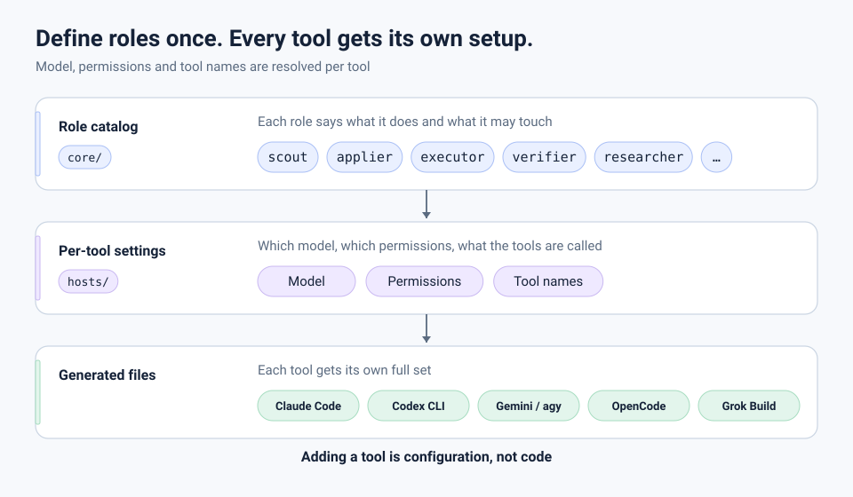
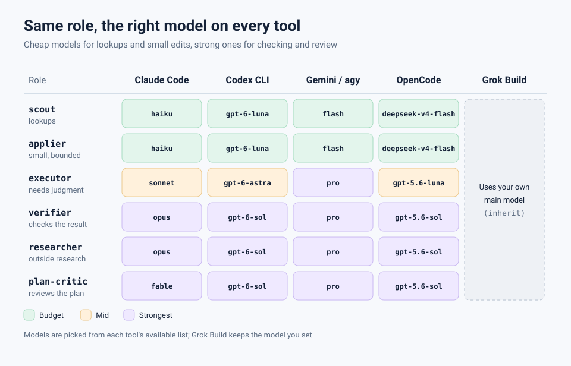
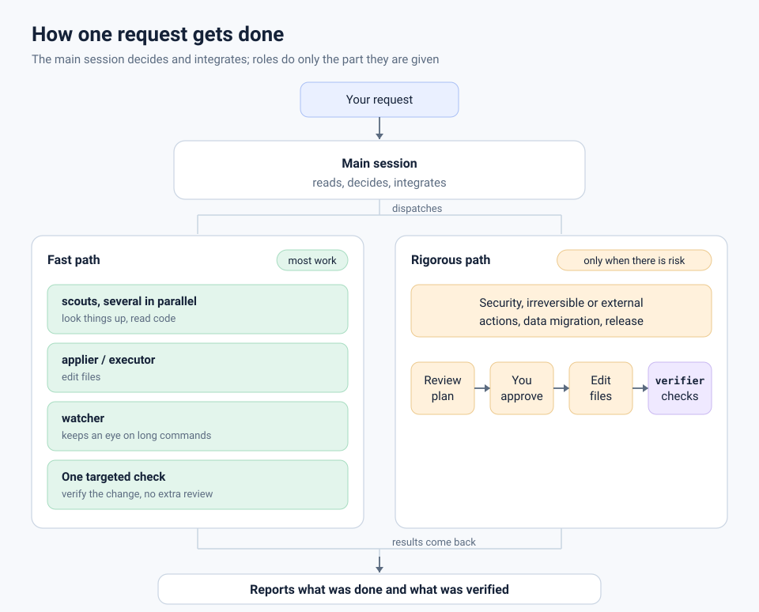
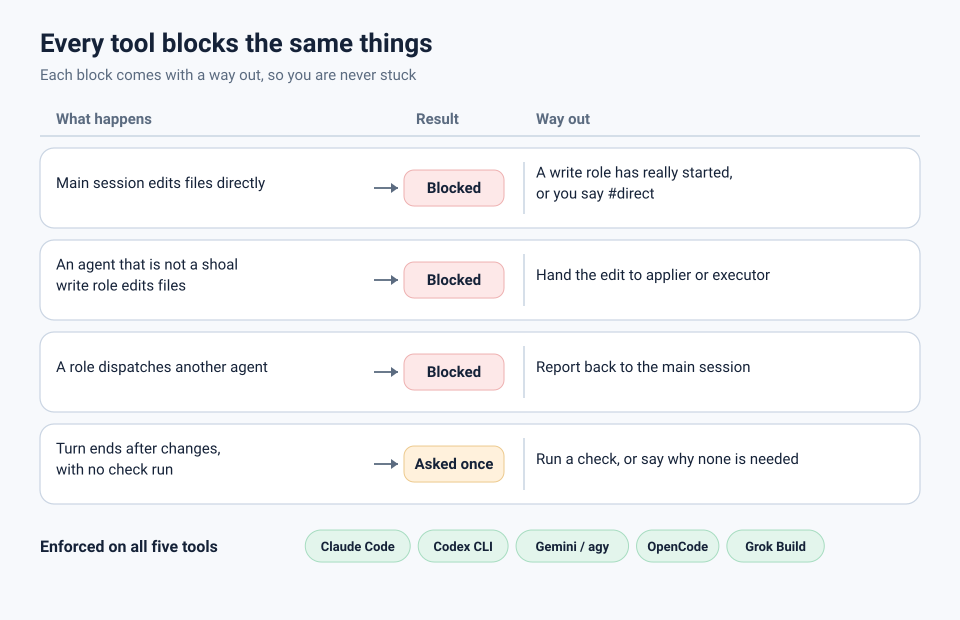
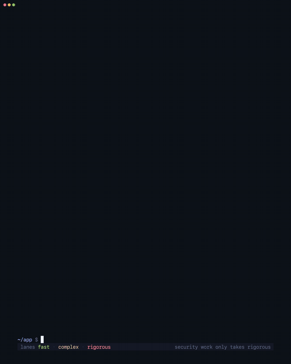

<!-- markdownlint-disable MD013 -->
# shoal

Define agent roles once. shoal resolves the model, permissions and prompt for each agent tool; adding a new tool is configuration, not code.

English · [繁體中文](docs/README.zh-TW.md) · [简体中文](docs/README.zh-CN.md)

## What it does

- One role definition gives each of the five hosts a fitting model, permissions and prompt.
- The main session judges and integrates; edits and long commands go to the matching role.
- A guard enforces the delegation rules on every host, so they do not depend on the model remembering them.
- Supporting a new tool means filling in configuration, not writing code.

## How it works



Roles live in core. Each host's binding says which models and permissions it has, and `render.py` produces the files to install.



A role names a tier, not a model. Each host picks the matching model from its own catalog.



The main session looks at the shape and risk of the work, then does it itself, hands it to a role, or runs the full review flow.



If the main session edits a file without dispatching a writable role, or a subagent that is not a shoal writable role edits one, the guard blocks it. The way out is to dispatch a writable role or add `#direct` to the prompt.

## Demos

### A large cross-module change

The main session turns a big change into a spec, then hands the slices to roles in parallel.

The demo recording was removed from the repo to keep it small; it remains in git history.

### A security-sensitive change takes the rigorous path

Changes to auth, secrets or permissions get a reviewed Plan first, then a security role carries it out.



## Quick start

shoal is in beta: a beta minor release may break things, and stable starts at 1.0.0 ([Versioning](docs/reference.md#版本-channel)).

```bash
# preview first (dry run, writes nothing)
python3 tools/shoal_install.py --host codex
# install; --host can be claude、codex、grok、opencode、agy
python3 tools/shoal_install.py --host codex --apply
```

It needs only `python3` (stdlib). macOS and Linux are supported; Windows is experimental. Without `--apply` it is a dry run that shows the underlying installer's preview; when an external CLI such as `claude`, `codex` or `bun` is missing, the dry run reports `skipped`. opencode needs `bun` for `--apply`.

Claude Code also has the plugin marketplace route (latest stable):

```bash
claude plugin marketplace add miyago9267/shoal
claude plugin install shoal@shoal
```

Per-host details, and Claude Code without the plugin, are in [INSTALL.md](./INSTALL.md).

## Modules

Install only what you need: `python3 tools/shoal_install.py --host <h>` prints the commands (dry run); add `--apply` to install.

Skip the dispatch guard with `--without dispatch-guard`; `--list` shows the modules and what is installed.

External guards plug in through the guard chain: register one with `--chain-add`, no change to shoal needed.

Details: [INSTALL.md, Modules](./INSTALL.md#模組).

## Supported hosts

| Host | Install | Guard |
| --- | --- | --- |
| Claude Code | plugin, or `tools/install_hooks.py` | hook, blocks by default |
| Codex CLI | `install/install.sh` | hook, approve once in `/hooks` |
| Gemini/agy | `hosts/agy/dist` plus `tools/install_hooks.py` | hook, blocks by default, no `#direct` |
| Grok Build | `tools/install_grok.py` | native hooks |
| OpenCode | `install.sh --enable` | built into the plugin |

## Fast and rigorous

The default path is fast: the main session reads, diagnoses and integrates by itself, and hands edits to a writable role. Risky or large work takes the rigorous path: plan review, approval, then verification when it is done. To let the main session edit directly, you can add `#direct` to the prompt. To run a whole session fast, you can add `#fast` to a prompt: the main session may edit directly, while the hard rules (roles do not dispatch further, reviewers do not edit) and the end-of-turn check stay. You can turn it off with `#strict`; for tools without prompt text (agy), set `SHOAL_GUARD_FAST=1` instead.

## shoal and pilotfish

shoal derives from [Nanako0129/pilotfish](https://github.com/Nanako0129/pilotfish); on the Claude side it forked from pilotfish v1.4.2. pilotfish is now v1.5.0 (2026-10-10), a multi-model orchestration policy for Claude Code whose plugin is out of beta. Other tools have sister projects (pilotfish-grok, pilotfish-codex, remora).

| Aspect | pilotfish | shoal |
| --- | --- | --- |
| Scope | Mainly Claude Code, one project per other tool | One role definition rendered to 5 hosts |
| Delegation | The main session judges net benefit and does small, local work itself | Edits always go to a writable role (`#direct` is the exception) |
| Enforcement | Hooks block only hard rules (a leaf cannot dispatch, a verifier cannot edit) | Also blocks the main session editing directly, non-shoal agents editing, roles that never started, and ending a turn after edits with no check |
| Evidence | Each decision comes with benchmarks and measurements | Mostly payload captures and per-host live tests, with fewer measurements |

shoal does not replace pilotfish, and it is not simply a newer version of it. It extends the roles and rules to several vendors and adds enforcement, at the cost of being heavier and stricter. If you only use Claude Code and want a light policy backed by measurements, use [pilotfish](https://github.com/Nanako0129/pilotfish); if you use several agent tools and want one definition with consistent enforcement, use shoal.

## Further reading

- [INSTALL.md](./INSTALL.md): full install steps, guard rules and environment variables.
- [docs/DESIGN-INVARIANTS.md](./docs/DESIGN-INVARIANTS.md): the design rules that do not change.
- [docs/new-host.md](./docs/new-host.md): how to add a host.
- [CHANGELOG.md](./CHANGELOG.md): release history.

## Credits

shoal derives from [Nanako0129/pilotfish](https://github.com/Nanako0129/pilotfish). The grok host's orchestration rules and agent text come from [Nanako0129/pilotfish-grok](https://github.com/Nanako0129/pilotfish-grok) v1.0.6; shoal adds core rules, native hooks and an installer, and `upstream.lock` records the version. The codex host was originally `miyago9267/pilotfish-codex` and has lived in this repo since v1.0.0; refs pinned before v1.0.0 remain in [pilotfish-codex](https://github.com/miyago9267/pilotfish-codex). Upstream Pilotfish's copyright and license terms carry over; see `LICENSE`.
