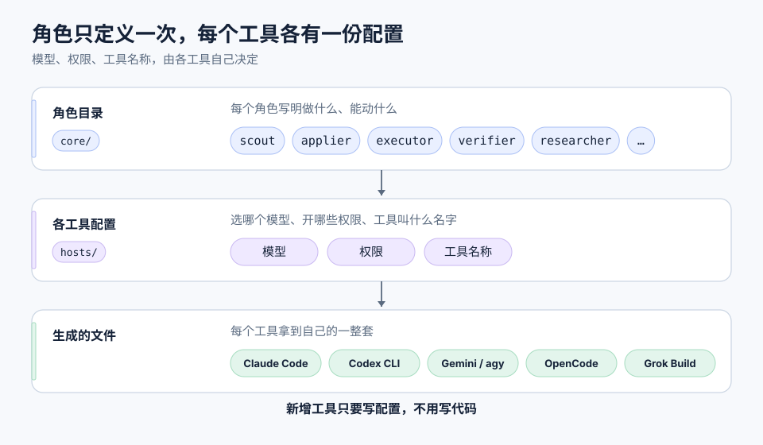
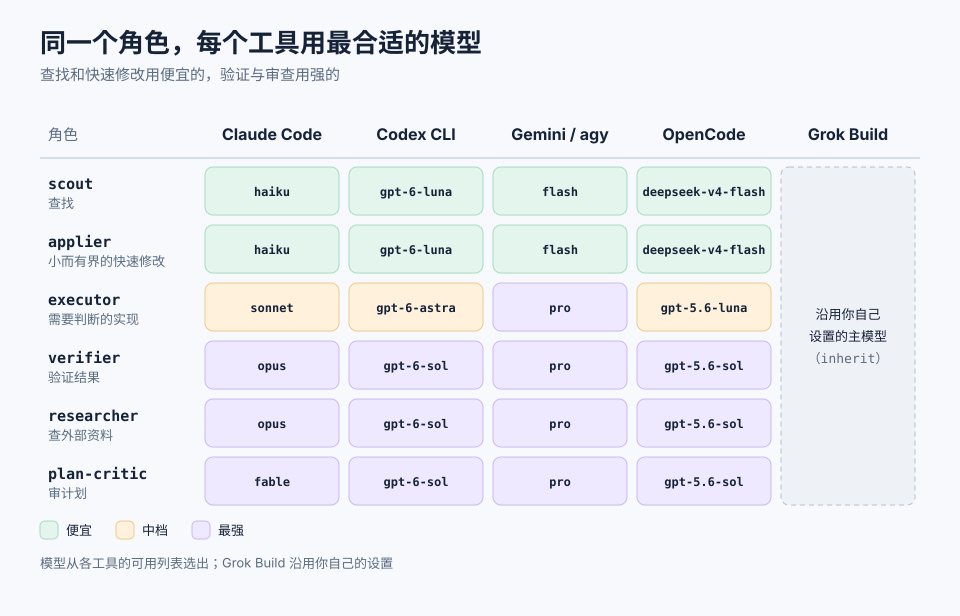
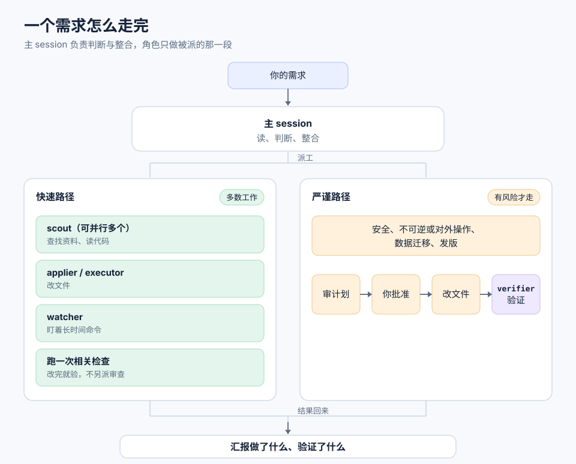
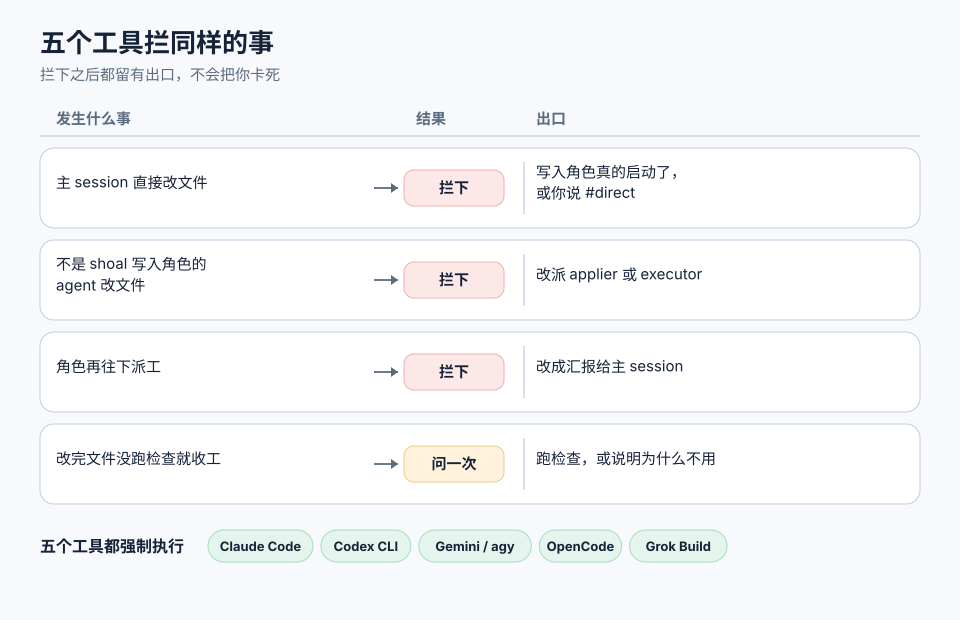

<!-- markdownlint-disable MD013 -->
# shoal

只需定义一次 agent role，shoal 就能根据各厂牌 agent 配好模型、权限与 prompt，自动 orchestration；无需编写任何代码。

[English](../README.md) · [繁體中文](./README.zh-TW.md) · 简体中文

## 它解决什么

- 一份 role 定义，五个 host 各自拿到合适的模型、权限和 prompt。
- 主 session 负责判断与整合，改文件和长命令交给对应的 role。
- 派工规则由 guard 在每个 host 强制执行，不靠模型自觉。
- 要支持新工具，填配置就行，不用写代码。

## 运作方式



role 写在 core，每个 host 用 binding 说明自己的模型与权限，再由 `render.py` 生成安装文件。



role 只写 tier，不写模型名称；每个 host 从自己的模型目录里挑出符合的那一个。



主 session 先看工作的形态和风险，再决定自己做、派给哪个 role，还是走完整的审查流程。



主 session 没派可写 role 就改文件，或 subagent 不是 shoal 的可写 role 却改文件，都会被拦；出口是改派可写的 role，或在 prompt 里加 `#direct`。

## 快速开始

```bash
# 先看会做什么（dry-run，不写入）
python3 tools/shoal_install.py --host codex
# 安装：--host 可换成 claude、codex、grok、opencode、agy
python3 tools/shoal_install.py --host codex --apply
```

只靠 `python3`（stdlib）。支持 macOS 与 Linux，Windows 为实验性支持。不带 `--apply` 是 dry-run，会显示底层 installer 的预览；`claude`、`codex`、`bun` 这类外部 CLI 找不到时，dry-run 报告 `skipped`。opencode 需要 `bun` 才能 `--apply`。

Claude Code 另有 plugin marketplace 的替代方式（装最新稳定版）：

```bash
claude plugin marketplace add miyago9267/shoal
claude plugin install shoal@shoal
```

每个 host 的细节与不用 plugin 的 Claude Code 见 [INSTALL.md](../INSTALL.md)。

## 模块

只装需要的部分：`python3 tools/shoal_install.py --host <h>` 默认只打印将执行的命令，加 `--apply` 才安装。

不要派工守门就加 `--without dispatch-guard`，`--list` 列出模块与已安装状态。

外部 guard 经 guard chain 接入：用 `--chain-add` 登记，不需要改 shoal。

细节见 [INSTALL.md 的模块](../INSTALL.md#模組)。

## 支持的 host

| Host | 安装方式 | guard |
| --- | --- | --- |
| Claude Code | plugin，或 `tools/install_hooks.py` | hook，默认拦截 |
| Codex CLI | `install/install.sh` | hook，需在 `/hooks` 里批准一次 |
| Gemini/agy | `hosts/agy/dist` 加 `tools/install_hooks.py` | hook，默认拦截，没有 `#direct` |
| Grok Build | `tools/install_grok.py` | 原生 hooks |
| OpenCode | `install.sh --enable` | plugin 内置 |

## 快速与严谨

默认走快速路径：读文件、诊断和整合由主 session 直接做，改文件交给可写的 role。遇到风险或大型工作才走严谨路径：计划审查、批准，完成后再验证。想让主 session 自己改文件，可在 prompt 里加 `#direct`。若要整个 session 都走快，可在 prompt 里加 `#fast`：主 session 可以直接改文件，硬规则（role 不再派工、审查 role 不改文件）和结束前的检查照旧。可用 `#strict` 关闭；没有 prompt 文字的工具（agy）则设 `SHOAL_GUARD_FAST=1`。

## 与 pilotfish 的关系

shoal 衍生自 [Nanako0129/pilotfish](https://github.com/Nanako0129/pilotfish)，Claude 端以 pilotfish v1.4.2 为分叉基准。pilotfish 目前是 v1.5.0（2026-10-10），是 Claude Code 的多模型 orchestration policy，Plugin 已脱离 beta；其他工具各有姊妹项目（pilotfish-grok、pilotfish-codex、remora）。

| 方面 | pilotfish | shoal |
| --- | --- | --- |
| 支持范围 | 以 Claude Code 为主，其他工具各一个项目 | 一份 role 定义 render 成 5 个 host |
| 派工判断 | main 按净收益判断，小而局部的工作自己做 | 改文件一律交给可写 role（`#direct` 例外） |
| 强制范围 | hook 只拦硬规则（leaf 不再派工、verifier 不改文件） | 另拦 main 直接改文件、非 shoal agent 改文件、role 未启动、改完没检查就结束 |
| 证据 | 每个决定都附 benchmark 与测量 | 以 payload 抓取和各 host 实测为主，测量较少 |

shoal 不取代 pilotfish，也不是它的上位版本：它把 role 与条款扩到多个厂牌并加上强制执行，代价是更重、更严。若只用 Claude Code、想要轻量且有测量支撑的 policy，用 [pilotfish](https://github.com/Nanako0129/pilotfish)；要是同时使用多个 agent 工具、想要一份定义和一致的强制规则，用 shoal。

## 延伸阅读

- [INSTALL.md](../INSTALL.md)：完整安装、guard 规则与环境变量。
- [docs/DESIGN-INVARIANTS.md](./DESIGN-INVARIANTS.md)：不能改的设计原则。
- [docs/new-host.md](./new-host.md)：新增 host 的步骤。
- [CHANGELOG.md](../CHANGELOG.md)：版本记录。

## 来源与致谢

shoal 衍生自 [Nanako0129/pilotfish](https://github.com/Nanako0129/pilotfish)。grok host 的 orchestration rules 与 agent 原文取自 [Nanako0129/pilotfish-grok](https://github.com/Nanako0129/pilotfish-grok) v1.0.6，shoal 加上 core 条款、原生 hooks 与 installer；`upstream.lock` 记录版本。codex host 原本是 `miyago9267/pilotfish-codex`，v1.0.0 起并入本 repo；v1.0.0 之前的 pinned ref 仍在 [pilotfish-codex](https://github.com/miyago9267/pilotfish-codex)。上游 Pilotfish 的著作权与授权声明沿用，见 `LICENSE`。
